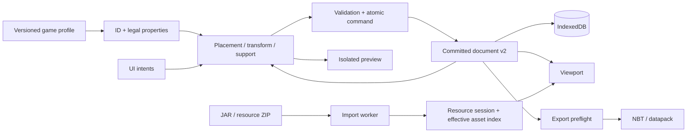

# 02 — Thiết kế kỹ thuật

Cập nhật: **03/11/2026**. Tài liệu này mô tả hợp đồng và cách vận hành source hiện
hành. Mục tiêu dài hạn ở [01 — Mục tiêu sản phẩm](01_PRODUCT_GOALS.md); trạng thái,
ưu tiên và bằng chứng nghiệm thu ở [03 — Tiến độ](03_STATUS_AND_ROADMAP.md).
Mục đánh dấu **định hướng** chưa phải chức năng đã triển khai.

## 1. Stack và môi trường

| Thành phần | Lựa chọn hiện hành | Vai trò |
| --- | --- | --- |
| Môi trường phát triển | Windows, Node 24.19.0 qua fnm, pnpm 11.20.0 | Theo `.node-version`, `package.json`, `pnpm-lock.yaml` |
| UI | React 19, TypeScript 6, Vite 8 | App local trong trình duyệt; chưa có backend/cloud |
| Viewport | Three.js 0.180, OrbitControls, TransformControls | Render, picking, navigation và gizmo |
| Dữ liệu ngoài | Zod 4, fflate 0.8 | Validate schema, ZIP/gzip và NBT writer |
| Lưu trữ | IndexedDB native | Resource packs, profile, document và thư viện component |
| Kiểm thử | Vitest 4, Oxlint, browser Edge/Chromium CDP | Domain tests, lint, browser integration |
| Công cụ game | Java 25 JDK hiện có qua mise | Extract profile và oracle đúng game version |

Giữ stack hiện có. Không thêm desktop runtime, framework, dịch vụ hoặc dependency
chỉ để đổi cách tổ chức code. Phiên bản patch cài thực tế do lockfile quyết định.
Java không bắt buộc để mở UI khi đã có profile; cần JDK cho các script developer.

## 2. Ranh giới module và nguồn sự thật

Subset bổ sung: block cell có optional strict `blockEntity: {kind:"chest",items:[]}`
chỉ cho `minecraft:chest[type=single]`. Placement mới khởi tạo rương rỗng; copy,
state/yaw/move, JSON/backup và Structure NBT giữ payload. Import chỉ nhận empty
Items và ID/coordinate fields đã hiểu; reject nonempty/unknown/paired payload.
Không có inventory editor/generic typed NBT. Context slab merge thay standalone
root cùng ID, giữ identity/Undo; không merge group/component hoặc Design.
Library có rename/duplicate persist-before-publish. WebGL loss tạm dừng frames,
restore dùng CPU resources hiện có; không đổi document/history.

| Module | Trách nhiệm |
| --- | --- |
| `src/core` | Schema v1 được giữ tương thích, game profile/catalog, state và phép xoay cơ sở |
| `src/editor/model.ts` | Document v2, object tree, component asset và validation |
| `src/editor/placement.ts`, `placement-plan.ts`, `support.ts` | Pair adapters, Design/Context, component yaw và support warnings thuần dữ liệu |
| `src/editor/operations.ts`, `history.ts` | Transform/group/component operations, preview và Undo/Redo atomic |
| `src/editor/entity-operations.ts`, `entity-action.ts` | Pig operations và exact-candidate plans; session/EntityPanel nhập số |
| `src/editor/neighbors.ts` | Opt-in scene connections cho fence/wall/gate, source index + sparse overlay, patch neighbors atomic |
| `src/editor/useEditorSession.ts` | Workspace session, command commit, document/component persistence |
| `src/io` | Archive worker, external input, IndexedDB, shared scene NBT/datapack writer |
| `src/resources` | Restore/import/pack precedence/profile orchestration; external store cho React |
| `src/render` | Model resolution, mesh baking, entity bindings và texture-image lifecycle |
| `src/viewport` | Three controller, camera, picking, gizmo/modal input và ghost overlay |
| `src/ui`, `src/App.tsx` | Workspace shell, thư viện, Inspector, dialogs và điều khiển |
| `scripts`, `scripts/java` | Extractor, asset audit, browser smoke và game-runtime oracles |



Block ID, string properties và integer cell là dữ liệu chuẩn. Mesh, texture,
numeric state ID runtime và camera không được dùng để thay thế dữ liệu document.
Registry chứng minh giá trị hợp lệ, không chứng minh support, placement hoặc render.
Pack override chỉ thay appearance; creative tabs/tags chỉ là facets tìm kiếm.

## 3. Game profile và resource pipeline

### 3.1 Profile hiện được hỗ trợ

| Thuộc tính | Giá trị đã đối chiếu |
| --- | --- |
| Minecraft Java | `26.2` |
| DataVersion | `4903` |
| Java runtime của game | `25` |
| Resource pack format | `88.0` |
| Data pack format | `107.1` |
| Client SHA-1 | `2dc72797acbc1b63fc16a11c4ac393605f453754` |

`scripts/prepare-game-profile.mjs` xác thực version/hash của client người dùng,
chạy `ExtractProfile.java` và tạo `public/generated/26.2.profile.json`. Profile
chứa ID, defaults, finite property domains, tags, creative tabs, thông tin block/
entity và baked entity model layers. Tập vanilla đã kiểm tra có 1.196 block,
158 entity type, 14 creative tab và 358 model layers; đây không phải số loại render
hoặc export đầy đủ. Texture entity đơn lẻ không chứa mesh/animation của game.

UI nhận JAR vanilla/resource ZIP và JSON profile riêng. Fabric Loader JAR không
thay thế client assets. Dev có thể đọc profile generated local khi chưa có bản lưu
hợp lệ; production yêu cầu nhập riêng. Profile không khớp fingerprint client bị
withhold; thiếu profile dùng catalog mẫu và báo giới hạn.

### 3.2 Import, precedence và lỗi

- ZIP/JAR parse trong worker, chuyển buffer và tính fingerprint; timeout 30 giây.
- Giới hạn: 128 MiB nén, 32 MiB/file giữ lại, 256 MiB tổng giải nén, 60.000 entries;
  kiểm path traversal, header/size và dữ liệu ngoài trước publish.
- Pack có provenance và fingerprint; gói trùng được nhận diện. Pack bật ở trên
  ghi đè asset trùng path; ưu tiên giảm dần rồi ID giải hòa để thứ tự xác định.
- Dùng một effective asset index chia sẻ; không scan/sort mọi pack cho từng texture.
- Mutation lưu thành công rồi mới publish; restore pack/profile độc lập, record
  lỗi được báo và giữ nguyên thay vì xóa cả workspace.
- Tài nguyên/profile ở local và IndexedDB theo origin. Đổi `localhost`, IP hoặc
  cổng là đổi kho dữ liệu; JSON document không nhúng assets hay game profile.

`vite.config.ts` đặt `build.copyPublicDir=false`: production không chép JAR,
texture hoặc generated profile. Chúng cùng cache, world thử và screenshot phải
được ignore. Không phát hành lại assets Mojang trong source/build.

## 4. Mô hình dữ liệu và persistence

### 4.1 Tọa độ và đối tượng

**+Y lên, +X đông, +Z nam; một đơn vị bằng một block.** Cell `(x,y,z)` chiếm vùng
`[x,x+1] × [y,y+1] × [z,z+1]`; tâm render là `(x+.5,y+.5,z+.5)`.
Kích thước model, occupied cells và state là ba khái niệm riêng: slab vẫn chiếm
một cell, dù mesh chỉ cao nửa block.

| Kiểu | Hợp đồng |
| --- | --- |
| `BlockState` | `{ name: namespacedID, properties: Record<string,string> }` |
| `Block` | `{ pos: integerVec3, state }`; không chứa mesh hoặc payload NBT tùy ý |
| `EditorObject` | `id/name/kind/cells/children/pivot2/orientation/componentId?` |
| `block` | Một cell, không children |
| `multiblock` | Leaf chứa đủ cặp cell/state; không cho chỉnh rời từng nửa |
| `group` | Children giữ identity/state/pivot, group không có cells trực tiếp |
| `component` | Instance có cells hoặc children; bản sao độc lập, provenance tùy chọn |
| `EditorDocument` | Schema 2, `id/name/workspace/target/objects/entities` |
| `ComponentAsset` | Schema 1, `id/name/objects/size/pivot2/orientation` |
| `SceneEntity` | ID/type, vị trí thực và yaw; payload/entity editor đầy đủ chưa có |

Cells và nested pivots là tọa độ tuyệt đối trong document. Asset tạo từ selection
được normalize theo minimum bounds. Top-level owner xác định selection; muốn sửa
child của group cần Ungroup. Component hiện dùng ID mới khi đặt, không cập nhật
live khi sửa nguồn. Không nhầm cơ chế này với template references của domain v1.

Schema strict kiểm cycle, depth, ID trùng, occupancy và giới hạn công việc. Document
hiện tối đa 100.000 objects/cells, depth 16, entities 1.000; không phải cam kết FPS.
Unknown properties/NBT bị từ chối rõ ràng khi chưa có schema/adapter, không bỏ ngầm.

**Entity domain N04 — subset hiện hành:** `entity-operations.ts` cung cấp
`addEntity`, `moveEntities`, `setEntityYaw`, `duplicateEntities`, `removeEntities`.
API nhận document/catalog và entity IDs riêng, không trộn với object selection.
`entityEditCapability` chỉ cấp phép pig; render/export/registry support không tự
mở quyền edit loại khác. Đã nối session/EntityPanel theo numeric-first subset N05.
Vị trí là tọa độ thực trong bounds schema, delta World không snap; yaw finite được
normalize modulo 360 khi thêm/đặt yaw. Duplicate giữ nguyên yaw nguồn và nhận một
ID mới cho mỗi entity theo thứ tự chọn; ID mới không trùng entity hoặc nested
object hiện hữu. Legacy cross-kind IDs vẫn đọc được và chỉ target entity list;
UI tương lai phải phân biệt namespace identity, không dùng bare ID chung.
Unsupported/missing/duplicate selection hoặc một kết quả vượt bounds chặn cả
batch. Entity có thể trùng vị trí nhau hoặc block; đây không phải simulation.
Full-validate base và candidate; cap 1.000 trước add/duplicate expansion, không
mutate input hoặc block objects. No-op giữ document reference để không xóa Redo.
Candidate ghi qua history metadata hiện có thành một Undo/Redo; không tạo writer
lưu trữ riêng. Action plan giữ exact candidate, source/epoch/revision/catalog/view
guards; session giữ entity selection riêng và hủy preview khi đổi context.
EntityPanel có Preview/Confirm/Cancel/Esc; viewport chỉ thay entity list để xem
candidate, Save/draft giữ committed data. Y-range kiểm anchor thực; block isolation
chặn edit entity, hidden/locked IDs vẫn chỉ thuộc block roots. Publish cả component
có entity bị chặn vì library schema chỉ có blocks. Ray selection/gizmo, entity
visibility riêng và coverage ngoài pig còn thiếu; chưa là world proof.

### 4.2 Lưu trữ và lifecycle

IndexedDB `blockstage-studio` v7 giữ các stores cũ `projects/packs/catalogs/profiles/
preferences/editorDocuments/componentAssets/editorRevisions`, thêm `editorDraftHeads`
và `editorDrafts`. `editorRevisions` tiếp tục là sidecar Saved; head draft có index
`status/documentId`, payload nằm riêng để listing/retention không load mọi snapshot.
Upgrade chỉ tạo store còn thiếu, không ghi lại snapshot, không đổi document v2.
Legacy project v1 không bị
migrate ngầm; chỉ chuyển khi người dùng Open JSON, coalesce pair đầy đủ và báo lỗi
nếu thiếu/mismatch. Transaction chỉ thành công tại `oncomplete`; version change
đóng handle, blocked upgrade yêu cầu đóng tab cũ và giữ dữ liệu.

Architecture và Component có document/history/selection riêng. Preview chỉ đọc
document nguồn; Assets preview hoàn toàn tách khỏi công trình. Save lưu snapshot;
New/Open/Import/Edit component bảo vệ draft có sửa trước khi chuyển, không tự
nâng thành Saved; placeholder mới chưa sửa và checkpoint sạch không tạo recovery.
`pristine` theo identity/history,
không suy từ tên Untitled hoặc số cell; Save chủ động vẫn lưu bản rỗng.
Chọn asset, camera, ghost hoặc mở export không tạo history.
Đã có draft autosave và explicit recovery (§4.3); chưa có Undo journal qua reload.

`src/io/editor-repository.ts` là đường đọc/ghi editor documents. Save nhận snapshot
và expected token `{generation, version}`; `null` chỉ cho ID chưa từng tồn tại.
Record v5 chưa có sidecar được đọc bằng token `legacy/0`, chỉ nhận generation mới
khi Save rõ ràng. So token, ghi snapshot/revision và active preference trong cùng
readwrite transaction; chỉ ack tại `oncomplete`. Không tự retry conflict bằng token
mới. Phiên mở có epoch riêng; ack chỉ đánh dấu snapshot đã gửi, edit trong await
vẫn Unsaved. Save chồng trong một workspace bị từ chối để retry sau khi Save xong.

Repository có remove CAS: xóa snapshot, giữ tombstone và chỉ bỏ preference đang
trỏ đúng ID trong cùng transaction; không xóa asset/copy/workspace khác. Token cũ
và `null` không thể ghi lại ID đã xóa. Chưa có restore document đã xóa hoặc tự dọn
tombstone. `activate` so token khi mở/restore checkpoint rồi ghi preference trong
transaction để thao tác mở đến muộn không phục hồi pointer đã xóa. Save metadata
ngoài document hiện tại dùng `activate:false`, không đổi active preference.

`DocumentManager.tsx` lazy-load từ nút Documents: tìm theo tên/ID, lọc workspace,
40 hàng mỗi trang, trạng thái Current/Saved/Not saved, cell count/version/ID và
thời điểm lưu nếu có. `updatedAt` chỉ để hiển thị/sắp xếp, không dùng làm CAS;
record cũ không có timestamp vẫn đọc được, không dựng ngày giả. Đổi tên active
chỉ khi sạch; dirty document đổi tên tại thanh chính rồi Save hoặc discard trước.
Xóa/discard có xác nhận theo snapshot đã xem. Lỗi transaction giữ hàng và local
data; active delete chuyển sang placeholder mới, xóa matching preference, reset
selection/history. Discard trở lại Saved checkpoint hoặc bỏ document chưa Save;
không delete Saved. Đây là IO/lifecycle, không tạo command để Undo phục hồi file.

New/open/import/edit component/publish/rename/delete/discard khóa workspace trong
lúc await; Save riêng vẫn cho sửa tiếp. Ref slot đồng bộ cùng state update để
callback tiếp theo không dùng token đã cũ trong cùng tab. Component asset và bản
làm việc mới dùng ID khác nhau; `componentAssetId` tùy chọn trong revision sidecar
giữ nguồn thư viện qua reload, không tạo linked instance. Binding cũ doc ID bằng
asset ID vẫn đọc được; không rewrite ngầm. JSON document v2 không mang binding
thư viện local; portable v1 mang library copies riêng (§4.5). Publish thư viện và Save
document là hai IO riêng: Save lỗi không rollback asset đã xuất bản.
Conflict giữ document local, hướng dẫn xuất JSON backup rồi reload/mở bản lưu.
Chưa có màn hình merge giữa tab; Documents Refresh đọc lại Saved list,
CAS từ chối stale rename/delete/save. Recovery invalidation chỉ gửi notification
qua BroadcastChannel khi có, không gửi snapshot; session cũng refresh khi focus.

### 4.3 Draft controller và recovery — K04/D02/D03

`draft-controller.ts` là scheduler thuần: một snapshot pending mới nhất, một write
in-flight, debounce 750ms và deadline 5s. Không ghi ghost/camera/palette/selection.
Tab nền/tắt browser có thể throttle hoặc hủy job; deadline không cam kết flush
thành công khi trang đóng. Visibility/pagehide flush là best effort; beforeunload
cảnh báo nếu latest revision chưa được bảo vệ. Không hứa chống mất điện/crash mọi lúc.

Slot có `revision` tăng đơn điệu sau commit/Undo/Redo, `savedRevision` của snapshot
được Save ack, `epoch` lần mở và `draftId` của stream. Storage Saved version là
trục riêng. ACK cũ không đánh dấu Protected cho edit mới hoặc workspace/session mới.
Lỗi draft giữ latest pending, không retry nóng theo mỗi phím; Retry ghi latest.
Không dùng token mới đọc lại để retry snapshot đã stale.

`draft-repository.ts` ghi head + payload trong transaction cùng Saved/revision để
kiểm base token. Stream có ID/epoch riêng từng lần mở, local revision phải mới hơn
head hiện tại; hai tab không overwrite chung một draft. Head retired giữ tombstone,
payload được bỏ. Save pause/drain controller, ghi checkpoint và retire **own** stream
atomic; edit trong await giữ dirty và được bảo vệ ở stream mới với base mới. Save
đến muộn sau discard bị chặn. Delete document retire **mọi** stream theo documentId;
discard current chỉ retire own stream và cập nhật matching Saved preference atomic.
Undo editing không phục hồi các IO này. Save/library publish vẫn là hai IO riêng.

Retention: tối đa 32 live drafts và 64 MiB tổng JSON UTF-8 payload, mỗi snapshot
32 MiB, ngoài các giới hạn document v2. Reject overflow và giữ mọi bản cũ; người
dùng tải JSON hoặc discard rõ ràng để dọn. Không auto-evict theo tên/time/cell count.
Listing chỉ đọc bounded heads; payload được schema/size/identity/metadata validate
khi load/restore. Record sai được giữ nguyên và báo lỗi. Tombstones không tự GC.

Documents phân Saved/Recovery. Reload mở checkpoint Saved theo preference rồi
**offer recovery**, không tự thay công trình. Restore compare revision/epoch đã xem,
kiểm Saved base còn nguyên, retire source và tạo stream mới + pointer trong cùng
transaction. Saved checkpoint vẫn giữ; history bắt đầu lại ở snapshot phục hồi.
Saved base đã đổi/xóa thì không resume ngầm. Recover copy dùng document ID mới,
base null và bỏ library publication binding; Restore nguyên bản giữ binding nếu có.
Xóa Saved đã vô hiệu hóa mọi recovery của nó thì không offer lại từ các stream cũ.
Download JSON recovery là document v2, chưa phải portable project bundle D05.

BroadcastChannel chỉ invalidation/đếm recovery, có fallback Refresh/focus; CAS mới
là hàng rào đồng bộ. Không phải merge/multiplayer. Recovery độc lập Architecture/
Component, đọc được dữ liệu khi thiếu assets/profile; rendering vẫn báo fallback.

### 4.4 Storage health — D06

Documents → Storage dùng `src/io/storage-health.ts` và `StorageHealthPanel.tsx`.
Mở panel/Refresh chỉ gọi `estimate()` và `persisted()` độc lập; không mở/scan IDB,
không tự yêu cầu persistence hoặc sửa document/history/draft. Chỉ click nút
Request gọi `persist()` ngay trong user activation, không await probe trước.
Controller gộp request đang chờ, timeout 10s và cleanup timer; unmount panel bỏ
qua kết quả UI cũ. Timeout không hủy request nội bộ của browser.

API thiếu/denied/read error/request error có trạng thái riêng. Estimate thiếu,
NaN, âm hoặc nonfinite hiển thị Unavailable thay vì 0; quota 0 không tính ratio.
Probe thất bại không xóa kết quả thành công của probe khác. Refresh thay snapshot
thống kê cũ; không giữ số usage cũ như thể vừa đo lại. Cảnh báo từ ratio ≥90% là
ngưỡng UX của Blockstage, không phải giới hạn API hay dự báo write thành công.
Progress chỉ clamp phần vẽ; số usage/quota không bị sửa.

Estimate bao gồm browser storage của **origin**, không phải dung lượng đĩa còn
trống, không phải tổng byte riêng document hoặc chỉ IndexedDB. Persistent storage
được browser cấp có thể giảm automatic eviction, không chống người dùng clear
storage, mất thiết bị, origin khác hoặc lỗi write; luôn giữ backup ngoài browser.
Không có auto-delete/cache cleanup, không nâng DB schema/dependency ở slice này.
QuotaExceededError của Save/import/draft tiếp tục theo failure/retry của chủ IO;
panel không bypass CAS/retention hoặc giả khôi phục một write đã lỗi.

Nguồn API đối chiếu: [StorageManager.estimate](https://developer.mozilla.org/en-US/docs/Web/API/StorageManager/estimate),
[persisted](https://developer.mozilla.org/en-US/docs/Web/API/StorageManager/persisted),
[persist](https://developer.mozilla.org/en-US/docs/Web/API/StorageManager/persist).
Browser acceptance dùng native read-only probe và injected grant/deny/absent/error
để kiểm UX; không tuyên bố đã được browser cấp permission thật trên profile người dùng.

### 4.5 Portable backup v1 — K06 subset / D05a / D05b

Documents → Backup tải/mở `.blockstage-backup.json`, dùng `portable-backup.ts` cho
codec/report/ID planning, `portable-repository.ts` cho atomic add và session cho
preserve/switch. Format `blockstage-portable`, version **1**, chứa một document
schema v2/target 26.2/4903 và tùy chọn toàn bộ component library schema v1 (copies).
Không gọi format version là Minecraft DataVersion, không phải full workspace backup.

Resource manifest chỉ có adapter `blockstage-editor-v2-copy`, ordered pack names/
enabled flags/source/fingerprint SHA-256 và profile source SHA-1 + SHA-256 của
JSON serialization. Pack local IDs và priority timestamps không là identity;
manifest ghi precedence từ orderedPacks. Không có JAR/textures/profile geometry,
tokens/preferences/history/recovery, camera hoặc preview. Profile SHA-256 chứng
minh serialized content khớp, không phải semantic equivalence hay game world proof.

Strict schemas từ chối fields/version/payload chưa hỗ trợ, không strip ngầm NBT.
Document string blockstates hợp schema nhưng thiếu/sai registry được giữ nguyên
kèm report; không default/rewrite property. Restore không cần catalog/assets để
đọc dữ liệu, nhưng editing/export vẫn qua validation hiện có và có thể bị chặn.
Không hỗ trợ typed NBT/BigInt trong bundle này; mở schema payload phải version
format và thêm typed codec trước. Legacy document JSON vẫn dùng đường import cũ.

Trust boundary: 32 MiB UTF-8 JSON, 256 definitions, aggregate 100.000 cells/objects,
generic depth 64/work 2M nodes trước recursive schema; từng document vẫn giữ
limits depth/coords/IDs/occupancy/entities. Không ZIP/compressed input. File size
được kiểm trước đọc; unsupported/malformed input không chạm IO. Report giữ tối đa
100 notes cùng tổng count; có unknown profile/pack hash/order và component source
không bundled. Component instance đã bake là self-contained, source ID không là link.

Export chụp document/library committed snapshot trước async fingerprint; không
Save document hoặc publish geometry. Import preview không đổi store, cancel bỏ
candidate. Missing resource report cần acknowledgement Keep original data; user
reimport/reorder packs ở Resources, công cụ không tải hoặc đổi pack tự động.
Workspace mismatch yêu cầu chuyển workspace trước, không đổi source workspace ngầm.

Confirm kiểm current document identity, pause/drain draft controller và bảo vệ
current edits trước switch. Allocate fresh document/object/entity/component IDs,
remap bundled component provenance; source refs không bundled được giữ để truy vết.
Không mang publication binding của Component Editor cũ vào bản phục hồi. Transaction
`add` document/revision/library/preference cùng lúc; existing ID/tombstone/conflict
hoặc quota lỗi rollback toàn batch, không publish UI. Reimport tạo thêm bản sao.
Save/persistence về sau tiếp tục dùng CAS; restore IO không là editor Undo command.
Linked dependency closure, toàn bộ documents/recovery, partial library selection
và payload mở rộng chưa hỗ trợ ở phiên bản này.

### 4.6 Structure NBT import — blocks-only subset

Toolbar Import NBT lazy-load `ImportStructureDialog`; chọn file → worker validate →
report/explicit acknowledgement → session importStructure. `nbt-reader.ts` đọc
named big-endian root compound, TAG 1–12, typed long BigInt và typed lists/arrays;
duplicate fields, invalid tag/list lengths, UTF encoding/truncation/trailing data
bị reject. Java modified UTF-8 (NUL/surrogate) và standard UTF-8 supplementary
characters được đọc; không convert longs qua Number. Đây là reader nền hữu hạn,
không công bố N01 lossless reader/writer/typed-payload milestone đã hoàn tất.

Input raw hoặc gzip tối đa 16 MiB; DecompressionStream kiểm gzip, output stream
tối đa 32 MiB; depth 64, work 2M nodes, collection length ≤1M. Worker timeout 30s,
terminate khi cancel/thay file/unmount/error/success, transferable input buffer.
File read kiểm size trước; component không parse binary hay archive trên main UI.

`structure-import.ts` chỉ nhận DataVersion 4903, single `palette`, `size` ba số
dương ≤2048, `blocks` 1–100k. Pos phải integer 0≤pos<size, palette index hợp lệ,
không duplicate occupied cell. Palette dùng string IDs/properties exact, validate
bằng current catalog; không đoán/default unknown property. Thiếu registry yêu cầu
import profile, illegal state từ chối. `logicalCellGroups` ghép bed/door/tall plants;
incomplete/mismatched pair reject, validateDocument kiểm lại main thread khi commit.

Reject nonempty entities, block `nbt`, palette block có `hasBlockEntity`, multiple
palettes và unknown fields. Không drop unsupported data hoặc chuyển DataVersion.
Root author nếu có chỉ là thông tin: report rõ không giữ trong editor, cần policy
ack trước import. Size header được report nhưng empty border không thành document
geometry bounds; tọa độ explicit giữ nguyên, sparse gap không fill air. Air/cave_air/
void_air là cells explicit theo registry. Xoay/state mesh và auto-neighbor không tự
áp lại khi nhập. Entity-only template/NBT payload/format khác chưa hỗ trợ.

Confirm checks expected current document, protects draft, allocates new document
ID, dùng atomic add của portable repository (document/revision/preference; không
library assets). Failure/quota giữ document cũ, không UI publish trước oncomplete.
History mới bắt đầu sạch, import không là một command Undo. Export còn cap 48 theo
policy; dimension 2048 là import envelope, không cam kết edit FPS hoặc export lớn.
Không giữ root metadata chưa có contract ngoài acknowledgement author/size nói trên.

## 5. Tương tác, transform và placement

### 5.1 Input và atomic commands

Viewport sở hữu input camera/gizmo; React phát intent vào domain, không chứa luật
game. Phím chỉ xử lý đúng focus/session, không chặn typing trong input. Gizmo thao
tác proxy; không dùng Euler của mesh làm state đã lưu.

Mỗi thao tác đi qua **plan → preview → validate → commit/cancel**. Preview không
đổi committed document. Collision mặc định từ chối cả thao tác. Undo/Redo lưu object
patches, tối đa 64 commands và khoảng 500.000 cell payload giữ lại, luôn giữ command
mới nhất. Group/Ungroup không đổi cells/state; Undo một lần hoàn tác nguyên action.

Move dùng integer delta; Local theo orientation của active object. Whole-object
rotation chỉ yaw bội 90° có adapter, đồng thời xoay tọa độ và properties như
`facing/axis/rotation/side states`. Không xoay mesh tự do hoặc scale voxel liên tục.
`rotation` 16 bước còn có thể chỉnh qua state Inspector khi registry cho phép.

Pivot dùng **doubled integers `pivot2`**. Rotate kiểm parity của tâm cell, reject
phép xoay lệch nửa ô thay vì làm tròn. Clockwise yaw đưa north→east và offset
`(x,z)→(-z,x)`. Có Object origin, Selection center và Individual origins; re-anchor
pivot là command riêng, không di chuyển cells.

### 5.1.1 Chỉnh state chung

Inspector block state dùng `state-edit.ts` lấy giao thuộc tính và legal values của
toàn selection leaf. Cùng ID có đầy đủ fields hợp lệ; khác ID vanilla chỉ chia sẻ
semantics hữu hạn: axis, facing, rotation 16 bước, waterlogged, half top/bottom,
type slab bottom/top/double, khi domains tương thích. Các field chưa có semantics
cross-ID chỉ xuất hiện khi cùng ID; không suy compatibility từ family/tag.
Structural part/half của logical pairs và young pitcher crop luôn ẩn. Group hoặc
component trong selection chặn toàn bộ form state; không flatten children ngầm.

Giá trị khác nhau giữa objects hoặc cells trong logical pair hiện **Mixed**;
boolean dùng native indeterminate + aria-checked mixed và trạng thái hình ảnh riêng.
Chọn giá trị sửa duy nhất property đó qua `updateObjectsState`, dùng pair rewrite
hiện có rồi validate toàn document cuối cùng. Cho phép dùng cell được batch khác
giải phóng; collision cuối cùng từ chối toàn bộ. Session commit một history entry,
giữ selection; no-op không thêm history hoặc xóa redo. Không có neighbor/fluid
simulation trong state edit. Quy tắc này áp dụng Architecture và Component Editor;
Preview vẫn read-only. `updateObjectState` giữ API single-ID qua cùng planner.

### 5.2 Placement hiện hành

- `placement.ts` tạo đủ bed/door/tall-plant parts theo finite family adapters;
  cell click neo foot/lower ngay cả khi palette là head/upper.
- `placement-plan.ts` dùng chung cho ghost và commit. Design giữ palette state;
  Context derive axis cho 46 log/wood/stem/hyphae/bamboo IDs, type cho 68 slab,
  half/facing cho 64 stairs và facing cho bed/door. Thêm 9 chain IDs derive axis;
  10 lantern IDs derive hanging khi click mặt trên/dưới. Side click giữ hanging
  palette với note; chưa mô phỏng thứ tự tìm support thay thế hoặc fluid.
  Loại khác giữ state và có note.
- Slab/stair top khi click mặt dưới hoặc side-height `>0.5`; top face cho bottom.
  Facing theo hướng ngang camera; camera gần thẳng đứng giữ facing palette và báo.
- Các state ngoài phần derive vẫn tường minh: stair shape/waterlogged, occupied,
  hinge/open/powered. Không gọi Context là mô phỏng player placement đầy đủ.
- R/Shift+R trong Place đổi ghost yaw 90°, Esc về Select. Component quay cells,
  states, nested pivots quanh cell center hợp lệ rồi neo minimum bounds vào target.
  Source asset nguyên vẹn; không round pivot footprint không vuông.
- `createSupportChecker` cache scene/catalog indexes; candidate overlay tự cung cấp
  support nội bộ. Khi dùng cho transform preview phải loại các cells gốc bị thay
  thế; lookup placement không tự diễn đạt việc xóa cell cũ.
- Support warnings cho lower door và bảy terrestrial doubleplant families; soil
  list 26.2 hữu hạn: dirt, grass_block, coarse_dirt, podzol, rooted_dirt, mycelium,
  farmland, moss_block, pale_moss_block, mud, muddy_mangrove_roots. Unknown sturdy
  face/special plant báo uncertain. Bed đủ cặp không bắt buộc có sàn theo game.
- Warnings có vị trí block/support/owner, tối đa 100 chi tiết và overflow count,
  không chặn Design/export: world đích có thể chứa support ngoài document.
- Lantern/soul lantern khô: hanging đọc ô trên, standing đọc ô dưới. Chỉ stone
  và 9 chain khô đã được world oracle xác nhận: chain axis=y hợp lệ, x/z invalid;
  absent cell chưa biết world đích, explicit air invalid, loại/state/fluid khác
  unknown. Copper-lantern support, alternate side attachment chưa được mô phỏng.

### 5.3 Keymap và UI

**Auto connections** là session policy theo workspace, mặc định OFF kể cả sau
reload. Bật không rewrite document/imported states; sửa tiếp theo mới tính các
cell thay đổi và hàng xóm liên quan. Tắt giữ state tay. Profile cũ vẫn hợp lệ nhưng
control bị disable với hướng dẫn `prepare:game`/nhập lại profile. Không migrate
project hoặc pack để bật tính năng.

Profile v1 có thêm optional `neighborRules` và `dyeColors`. `ExtractProfile.java`
đọc actual Fence/Wall/Gate/IronBars classes, matching vanilla tags, exception-for-
connection, bốn sturdy faces và năm wall coverage predicates (N/E/S/W/post) trên
collision face phía dưới; **không** suy từ render mesh. Uniform shapes rút gọn;
state-varying shapes tra bằng property signature, `hasDynamicShape` để unknown.
Schema bound entries/properties/masks và tổng states. Metadata tách khỏi block
registry; generated profile vẫn là tài nguyên người dùng, không vào Git/build.

Planner dùng tọa độ document, coi cell không có là **air của scene thiết kế**;
không suy world đích cũng air. Fence phân biệt wood/nether, gate theo hướng;
wall xử lý low/tall/up theo bốn hướng/cover/post, gate cập nhật in_wall. Pane
được nhận diện làm hàng xóm của wall, chưa có auto-pane adapter. Fluid/redstone/
support ticks không chạy. Unknown rule/dynamic shape giữ explicit connections
của target với note giới hạn 20 mục. Có work limit để từ chối command quá mức.

Immutable source occupancy/roots cache bằng WeakMap; preview tạo sparse overlay
các roots thay đổi, không flatten/hash lại mọi cell không đổi. Queue lan qua
hàng xóm ngang và phụ thuộc phía dưới đến ổn định. Patch cập nhật nested group/
component cells, giữ ID/pivot. Ghost chứa cả neighbors bị đổi; session commit cùng
planner + document validation, Undo/Redo giữ toàn command và không chạy policy lại.
Các edit có thay đổi cells (place/delete/transform/batch states/component place)
đều qua commit gate; rename/camera/đổi policy không tự nối lại scene.

| Thao tác | Điều khiển hiện có |
| --- | --- |
| Orbit / pan / zoom | MMB / Shift+MMB / wheel hoặc Ctrl+MMB |
| Frame | Home frame all; F/Numpad . frame selection (fallback all khi chưa chọn) |
| 2D theo trục | Widget XYZ hoặc Numpad 1/3/7; view tự chuyển orthographic |
| Góc đối diện / projection | Ctrl+Numpad 1/3/7; Numpad 5 hoặc nút projection |
| Fly | Shift+grave, WASD, Q/E, Shift tăng tốc, Esc thoát; chưa collision |
| Chuyển công cụ | Q Select; E Place palette gần nhất; hủy staged edit, giữ selection |
| Selection | Click; kéo ≥5px chọn vùng xuyên; Shift-click/kéo toggle; B/Box vẫn có |
| Select all / clear | Ctrl/Meta+A hoặc A chọn editable roots; Alt+A bỏ chọn |
| Chọn trong Place | Alt+click chọn theo occupied cell và về Select; không đặt block |
| Transform | G chuyển Move từ mọi tool; R chuyển Rotate ngoài Place; axis/nhập số, Enter/click commit; Esc/RMB cancel |
| Place yaw | R/Shift+R hoặc nút mũi tên, không transform selection |
| Dựng vùng bằng chuột | Ctrl+LMB kéo trong Place block; mặt phẳng theo mặt đầu; thả để giữ preview, Enter commit / Esc cancel |
| Group / Ungroup | Ctrl+G / Ctrl+Alt+G |
| Save / Undo / Redo / Delete | Ctrl+S / Ctrl+Z / Ctrl+Shift+Z / Delete |

Viewport là trung tâm; toolbar/context, Inspector và outliner có trách nhiệm rõ.
Giữ dark surfaces, typography/khoảng cách/icon nhất quán; giải thích để trong
tooltip/help/details, không rải đoạn mô tả thường trực. Có keyboard focus, tên
truy cập, empty/loading/error và nút thay phím numpad; không đặt control giả.
Camera orbit/zoom không sửa document hoặc state. Ý nghĩa trục giữ Minecraft Y-up.

Select là mặc định khi mở/chuyển document, session hoặc workspace. Click/drag
được phân biệt trước khi sửa selection; gizmo bắt handle trước rectangle. Shift
được chốt lúc bắt đầu kéo. G/R có selection thì chuyển tool rồi mở modal trên
state mới; chưa chọn thì chỉ bật gizmo tool, không phát cảnh báo. Q/E có thể hủy
modal để chuyển trực tiếp; G/R trong modal thay thao tác mà không commit bước cũ.
Các hướng dẫn modal nằm trong Controls/HUD, không đẩy vào thông báo lỗi document.

Ctrl+kéo tái sử dụng `usePrimitiveActions`/`PrimitiveActionPlan`, không tạo writer
riêng. Chốt state từ `planBlockPlacement` ở điểm đầu (Design/Context + yaw), rồi
repeat template nguyên vẹn. Ray trong suốt gesture giao với mặt phẳng cố định
theo face đầu, khóa tọa độ anchor theo trục pháp tuyến; không re-pick bề mặt khác.
Release giữ nguyên End cho đến khi sửa số/Confirm; di chuột sau release không
đổi plan. Enter commit đúng finalized preview cùng stable operation IDs, revision,
budget/collision/neighbor/view guards; Undo một bước. Esc, pointer cancel, release
ngoài canvas hoặc mất window focus hủy gesture. Đổi nguồn/policy/tool/doc hủy
preview theo lifecycle hiện có. Giữ Place trong lúc bắt đầu gesture, dùng functional
state cho các endpoint đến trước render mới để tránh hủy/mất điểm do cập nhật
React đang chờ. Panel ẩn khi giữ chuột, hiện ở góc dưới khi thả; ở ≤1000px,
sidebar ẩn thì grid viewport cũng thu về một cột chiếm đủ chiều ngang.
Chỉ block palette; component vẫn Place/Repeat.
Không phải freehand paint hoặc dựng đường chéo.

Editor Select/Move/Rotate click chọn ô chiếm chỗ gần nhất, bỏ explicit air; không
phải click đúng triangle của chain/plant/model mảnh. `CellPicker` xây index chunk
16³ theo scene, loại chunk không giao ray rồi xét các cell ứng viên; không tạo
mesh proxy GPU hoặc đổi model/collision của game. Clip/local filtering áp dụng
trước khi xây index. Group chỉ chọn các cell con, không chọn khoảng trống giữa chúng.
Placement vẫn dùng mặt mesh cho slab/stairs và các loại thường; riêng 9 chain IDs
dùng mặt ô để nhắm đầu nối dễ hơn, có so khoảng cách với mesh phía trước. Đây là
quy ước tương tác editor, không phải tuyên bố game có hitbox full cube. Assets
preview/legacy picking giữ đường raycast model hiện có.

## 6. Renderer và hiệu năng

Editor ghost dùng chung baked geometry/texture/animation maps với committed
model, clone/cache material riêng theo source material, opacity nhân 0.45,
depthWrite=false, giữ depth test/cutout/tint; invalid preview nhuộm đỏ. Không sửa
material gốc hoặc dùng wireframe thay texture. Các cell cùng geometry/material
được gom InstancedMesh; khi đổi preview chỉ dispose instance resources, resource
invalidation/teardown mới dispose clone materials. Không dispose geometry/maps
mượn từ renderer. Explicit air không tạo ghost mesh; unsupported model giữ fallback
hiện có, không tuyên bố có model thật. Animation chỉ chạy khi material gắn scene
hoặc ghost đang sử dụng texture động. Đây chưa phải bằng chứng FPS GPU thật.

Resolver đọc parent/texture aliases, variants/weighted/multipart, elements/faces/
UV/uvlock/element rotation/rescale từ effective pack index. Baked geometry,
material và texture được reuse; JSON geometry có thể nhỏ hơn occupied cell.
Entity có 28 static bindings tường minh trong source; chỉ khả dụng khi có layer và
texture tương ứng. Thiếu geometry/binding có khung và lý do.
Chest special binding có thể render nhưng vẫn không export được khi thiếu payload.
Bed 26.2 dùng model JSON thường; không cần giả lập BedRenderer cũ.

`special-blocks.ts` thêm 32 banner IDs (16 màu standing/wall) và conduit. Geometry
lấy từ game layers; banner dùng standing/wall main + flag, origin (0.5,0,0.5),
scale (2/3,-2/3,-2/3), yaw rotation16/facing; màu từ DyeColor trong profile, hai
materials riêng cho gỗ/vải. Chỉ pose tĩnh và base color, không patterns/payload/
cloth animation. Conduit dùng shell + base texture ở tâm cell, chỉ inactive preview,
không suy activation từ waterlogged hoặc world. Thông báo partial luôn rõ; thiếu
layer/màu/texture có reason actionable, không cube giả accurate. Export block-entity
payload vẫn bị chặn. Model không elements chưa có adapter báo unsupported renderer.

Batch `InstancedMesh` theo chunk 16³ và render state; chunk âm dùng floor. Cache
viewport được reset khi đổi resource hoặc vượt ngưỡng bake/geometry 256, texture
512. Ownership phải dispose GPU objects, listener, worker, animation frame và URL;
`TextureImages` hủy request/handlers trước clear để tránh decode callback stale.

Render theo thay đổi; loop liên tục chỉ khi navigation/animation cần. Sprite dùng
`.png.mcmeta`, chỉ giữ frame loop khi texture animation thực sự được dùng. Ghost/
selection tách overlay, không rebuild base scene theo hover. Commit document vẫn
rebuild scene batches; dirty chunks, face culling/greedy meshing và DDA chưa có.
Outliner và block library phân trang; component catalogue render 24 cards mỗi
đợt, nhưng storage restore vẫn đọc toàn list. Không đưa toàn bộ document vào DOM diagnostics.

`texture-animation.ts` validate PNG/grid/frame/time trước decode, áp frame đầu
khai báo và lặp theo tick 50ms. Inset 0.01 texel ngăn nearest sampling lấy pixel
frame kế bên ở ranh giới UV. Đây là sửa frame bleed đã tái hiện; full-strip trong
ảnh người dùng chưa tái hiện với vanilla nhập mới, xem BUG-01. Không suy animation
cho texture thiếu metadata hoặc tự sửa pack đã lưu.

Face của element zero-thickness có face đối diện cùng plane dùng single-sided
material để không cùng vẽ hai polygon coplanar (campfire/fire). Entity, cube và
plane custom chỉ có một face giữ material policy cũ. Đây là face-culling của
renderer, không thay model, blockstate hoặc selection bounds.

**Định hướng tối ưu:** đo baseline trước, ghi CPU/GPU/driver/browser, cảnh và mix
model, p95 commit/picking, draw calls/triangles, memory và idle frames; sau đó mới
chọn incremental chunks, worker jobs, meshing hoặc picking mới. Cảnh 1k/10k/100k
là tập benchmark dự kiến; không phải dung lượng đã bảo đảm. Software WebGL/CPU
flatten không chứng minh FPS hoặc VRAM trên GPU thật.

### 6.1 Bộ đo P01/P02 và giới hạn số đo

`scripts/performance-fixtures.mjs` sinh scene deterministic 1k/10k/100k theo seed:
dense, sparse, mixed, transparent, pairs, component và entity. Giới hạn input
trước expansion; odd pair count có stone remainder, không tạo nửa giường/cửa.
Metadata có SHA-256 document, counts/bounds/chunks, nested depth và move commands
không va chạm theo Y+256. Không chứa game assets; không tăng import/history budget.

Lệnh dưới cần production preview đang chạy và các env URL/JAR/profile ở §8.3:

```powershell
fnm exec --using 24.19.0 pnpm.cmd measure:editor --cells 1000,10000,100000 --kinds dense --samples 30 --warmup 3 --renderer hardware --output editor-performance-hardware-dense-v2.json
```

Default đo root đầu tiên, dùng `--selection all` để đo cả scene. Các profile/kích
thước chưa chạy không tự nhận kết quả từ dense. `--renderer software` dùng
SwiftShader; hardware yêu cầu D3D11 nhưng report luôn lấy renderer thực tế để
phát hiện software/unknown, không gán đạt chỉ từ flag. Report local ở `artifacts/`
với basename do `--output` chỉ định; lỗi giữ report incomplete, không tính pass.

URL `?measure=1` bật `PerformanceProbe` tại ownership viewport. URL thường không
ghi measurement telemetry hoặc đọc timer/info mỗi frame cho probe. Revision key
chỉ là frame acknowledgement, không thay storage token/stale-plan guard. Native
pointer/key timestamp lấy trước editor handler; frame ack ghi sau render CPU
submission. Chọn xác nhận đúng owner/count; preview xác nhận đúng first-cell
position cuối; commit/Undo đối chiếu revision. V2 không chấp nhận preview của
chữ số trước trong cùng numeric input. Không dùng frame chỉ có boolean preview
để gọi là exact intent acknowledgement.

Warmup tách khỏi 30 mẫu p50/p95; chỉ đo pick, modal preview, commit, Undo. Ghi
import-to-frame của document trong process đã warm resource, CPU frame work,
draw calls/triangles, renderer resource counts, JS heap nếu API có, long tasks
theo từng case và idle frames trong một giây sau draft protection. Các phần
camera/save/retention dài hạn, GPU execution/presentation/FPS, VRAM/driver đầy
đủ và cold browser/cache chưa được đo. Render fallback blocks phải bằng 0 trước
khi lấy mẫu real-assets; resource/profile SHA-256 được ghi trong report.

Trong mỗi round so tối đa 64 cell diagnostics để tránh tải cả document vào DOM;
cuối case tải public JSON và so toàn bộ objects/cells/states/entities với fixture
ban đầu sau Undo. Số đo chạy headless với overhead probe; chưa tự trở thành SLO
phát hành. Move fixture Y+256 có thể đặt root khỏi camera, chỉ đo submitted
state/CPU pipeline; không phải GPU draw latency của root luôn nhìn thấy. Không
sửa gameplay, lịch sử hay user data để làm đẹp số liệu.

Phase attribution opt-in ghi synchronous spans cho transform candidate/neighbors,
full schema/state-pair validation, history diff/apply, session publish, flatten và
viewport rebuild. Collector giữ tối đa 4.096 events, báo số bị loại; chỉ tồn tại
khi measured viewport còn sống. Report có thời lượng và số lần gọi theo action.
Các span **inclusive, lồng nhau**, không cộng chúng thành tổng latency. React
reconciliation/passive effects và khoảng chưa instrument vẫn chưa được quy chiếu;
không có span không có nghĩa là không tốn thời gian.

Undo/Redo lọc selection theo các root còn tồn tại bằng một `Set` ID cục bộ cho batch,
giữ thứ tự và các ID lặp của selection đầu vào; không giữ child-only/vanished IDs.
Empty/single selection giữ direct lookup để không tạo index toàn document không cần
thiết. `history.selection` đo cả index construction và filtering, nằm trong span
`session.publish`; không cộng các span lồng nhau. View-policy pruning/isolate
reconciliation, revision, draft protection và patch history/retention giữ nguyên.
Index không cache qua Undo/Redo. `viewport.selection-outlines` đo riêng dựng viền;
loại membership scan không đồng nghĩa mọi bước Undo/render đều tuyến tính hoặc mượt.

Viền chọn compact được gom theo tâm chunk 16³ và màu active, dùng vertices tương
đối với chunk để tránh mất precision ở tọa độ xa. Giữ 12 cạnh, padding 0,015,
depth test và màu chọn; không tham gia picking. Root có bounds rộng hơn 1.024
block trên một trục dùng Box3Helper riêng để giữ phép biến đổi unit-box cũ thay
vì ép extents lớn vào Float32. Vì vậy sparse/wide selections vẫn có thể nhiều
draw calls; không cam kết batching mọi group. Tối đa 100.000 bounds, index Uint32
khi cần; mỗi drawable chỉ dispose geometry/material do nó sở hữu, không chạm
resources của block. Không đổi dữ liệu, history, schema hoặc persistence.

Import/load/commit và public `previewTransform` giữ full document schema. Mỗi lượt tạo registry
index và deduplicate state hợp lệ theo nội dung, không cache qua các lượt/document.
Sau schema và registry pass, footprint visitor vẫn kiểm complete pairs, shared
properties và cấu trúc logical mà không parse từng cell lần hai. Public standalone
logical validator vẫn strict. Transform commit tính candidate mới đồng bộ từ dữ
liệu hiện tại, giữ nguyên neighbor notes và commit đúng candidate vừa full-validate
một lần; không dùng preview UI cũ làm bằng chứng. Final view-policy guard và history
atomic vẫn chạy; import/persistence không nhận đường bỏ validation.

Preview Move/Rotate khi auto connections tắt có một session chỉ sống trong gesture:
full-validate immutable base/catalog một lần rồi dựng occupancy index theo root owner
(kể cả explicit air và các root không hiển thị). Candidate chỉ do các adapter private
giữ nguyên topology tạo ra: IDs, counts, metadata/entities và cây không đổi. Mỗi
preview kiểm whole changed roots bằng schema/registry/pair validator một batch, rồi
đối chiếu occupied cells mới với untouched roots; changed-selected collisions nằm
trong batch đó. Zero intent tái dùng base đã kiểm. Nếu subset/collision check thất
bại, chạy full validation để giữ đúng kết quả và ưu tiên lỗi của đường public cũ.

Controller chỉ giữ một context theo document reference, scope/epoch/revision,
selection/order, catalog reference, view policy, space/pivot và connection policy.
Nested base/catalog phải immutable; đây không phải cache cho dữ liệu mutable hoặc
validation token có thể lưu/nhập. Cancel/commit/publish document/selection/lifecycle,
workspace boundary/unmount loại proof/index. Auto connections dùng full preview path
kể cả khi chưa có neighbor rules. Commit luôn bỏ proof, tính candidate mới và full
validate; không thể dùng session này để bỏ validation tại trust boundary.
Base validation/index vẫn O(n), candidate/root diff còn quét danh sách roots; selection
toàn scene vẫn kiểm toàn nội dung đổi. Không tuyên bố mọi thao tác thành O(delta).
Probe tách `transform.validation-base`, `transform.base-index`,
`transform.validation-subset` và `transform.validation-fallback`; `validation.total`
luôn kiểm đầy đủ document argument, có thể là changed-root subdocument. Whole-sequence
report phân biệt full-scene với subset calls, không đếm subset như full-scene proof.

Block scene giữ snapshot theo chunk 16³, so owner/position/state để nhận thay đổi
trên immutable scene input. Mỗi lần update vẫn quét toàn visible cell list; chỉ
chunk thay đổi hoặc bị xóa mới tháo/tạo instance batches. Chunk không đổi giữ
`InstancedMesh`, instance buffer, shared geometry/material và snapshot picking.
Thứ tự cell trong chunk và thứ tự chunk hiện hành được giữ để ray ties ổn định;
owner-only replacement cũng phải refresh `userData.blocks`. Di chuyển resolve
model lại tại vị trí mới, kể cả trong cùng chunk, vì weighted variants phụ thuộc
tọa độ. Không suy geometry/model size thành occupied footprint.

Pack/profile/resolver/catalog thay đổi hoặc cache vượt ngưỡng cũ sẽ clear toàn
scene cache; ghost instance/material clones được tháo trước shared resources.
Chunk removal chỉ dispose instance-owned resources, không dispose shared maps/
geometry/material. Animations được tính lại từ committed meshes, entities và ghost
đang dùng. Entity meshes vẫn rebuild theo đường hiện tại; occupancy Set/flatten và
snapshot diff vẫn có chi phí O(n), chưa là incremental document index hoặc DDA.
Clip/local và editor hide/isolate/Y filtering cập nhật cùng snapshot render/picking;
không đổi collision/document/history policy. Opt-in probe ghi counters chunk thay
đổi, batch giữ lại và cell resolve; URL thường không serialize chúng ra DOM.

Numeric modal preview giữ intent mới nhất đồng bộ. Từ 25.000 visible cells, gõ số,
Backspace và thay axis khi có numeric text gộp đến frame sau idle deadline 75 ms
hoặc maximum deadline 200 ms mỗi pending window; nhỏ hơn ngưỡng giữ delivery tức
thì. RAF chỉ chạy khi có pending work; timeout fallback nếu môi trường thiếu RAF.
Đây là thời hạn scheduling, không bảo đảm wall-clock khi main thread bận/tab ẩn.
Pointer/gizmo không có numeric input vẫn theo đường hiện tại. Enter/click commit
hủy pending preview rồi chuyển intent cuối cho session full validation hiện hành;
không flush giá trị trung gian, không lấy preview cũ làm validation proof.

Esc/tool transitions, dispose, scene/revision/resource changes và transform context
(scope, view policy, catalog, auto connections, pivot mode/space) hủy pending work.
Callback-only render không tự hủy gesture. Queue giữ tối đa một intent, clear mọi
frame/timer trước callback để reentrant scheduling có window riêng. Invalid fractional/
NaN numeric input vẫn đi qua domain và bị từ chối, không làm tròn âm thầm.
Deferred delivery đi qua viewport bridge: `flushSync` publish React-owned ghost,
retire redundant scheduled viewport RAF rồi render ngay trong numeric RAF hiện tại.
Chỉ đường delivery deferred dùng bridge này, không dùng trong effect/start-modal,
commit hoặc pointer/gizmo thông thường; disposed controller không vẽ. Render vẫn
cập nhật animation/navigation và chỉ giữ frame kế nếu chúng đang cần. Đây là CPU
submission, không bảo đảm GPU completion/presentation. Probe ghi numeric schedule,
delivery, viewport props và whole-sequence counts ngoài final-key metric; mọi event
phải thuộc cửa sổ action, không lấy viewport event của commit/Undo đến sau.

### 6.2 Kiểm kê Fabric chỉ đọc

`pnpm check:fabric` tìm metadata versions ở vị trí `.minecraft` thông thường;
không đọc accounts/worlds/options/logs. Chọn instance bằng đường dẫn rõ ràng:

```powershell
fnm exec --using 24.19.0 pnpm.cmd check:fabric --instance 'C:\path\to\instance' --output artifacts/fabric-runtime-instance.json
```

Script đọc exact version JSON, embedded client version, loader coordinates,
root mod `fabric.mod.json` và SHA-256, resource-pack manifests/hashes, known mise
Java release metadata. Có budget entry/archive/aggregate và containment chống
junction; output chỉ trong workspace artifacts. `--probe-java` là opt-in chạy
`java --version` trên JDK mise đã có; không cài hay sửa launcher.

Kết quả là inventory, không tự chọn cấu hình đang chơi, resolve enabled/nested
mods hay Java launcher. Không launch Minecraft/server, accept EULA, đọc/sửa world
hoặc cài bridge. `worldReadback` luôn UNVERIFIED. Q02 chỉ đóng sau enable/reload/
place/readback trên world thử với runtime định danh; không suy từ metadata.

## 7. Export và giao tiếp game

`editor-export.ts` preflight committed document v2 rồi chuyển explicit cells thành
`StructureScene`, dùng shared writer `structure.ts` với adapter project v1. Không
dựng project v1 giả, không đọc mesh, không áp orientation lần hai lên cells đã xoay.
Export dialog lazy-load, chụp document/catalog snapshot; tải file không ghi history.

Preflight chặn schema/version/state sai, nonfinite/fractional cell, duplicate IDs/
occupancy, incomplete pair, thiếu provenance/adapter, unsupported entity và block
entity cần payload. Giữ tập demo finite cho export không có profile. Support là
warning, không tự sửa thiết kế. NBT big-endian được gzip; palette giữ legal strings.

Writer normalize minimum block và floor(entity position) chung về 0,0,0; entity
giữ phần lẻ/yaw. Hierarchy/pivot/provenance chỉ ở JSON backup. Giới hạn hiện tại
48 cell mỗi chiều là chính sách sản phẩm, không phải giới hạn tổng quát của NBT.
26 entity types có basic `id/Pos/Rotation` whitelist; payload khác chưa hỗ trợ.
Sparse gaps không ghi cell, giữ nguyên đích; explicit air được ghi để xóa đích.

| Đường xuất | Nội dung / sử dụng |
| --- | --- |
| Datapack ZIP | `pack.mcmeta` min/max `[107,1]`, `data/blockstage/structure/build.nbt`, README |
| NBT riêng trên 26.2 | `<world>/generated/blockstage/structure/build.nbt` — `structure` số ít |
| Lệnh đặt | `/place template blockstage:build ~ ~ ~` |

Chép ZIP vào `<world>/datapacks`, bật commands và `/reload`; thử trong Creative
world riêng. Mỗi ZIP dùng ID `blockstage:build`, chỉ bật một pack để tránh override.
UI không ghi trực tiếp world đang mở. `.schem/.litematic`, generic NBT, Fabric
bridge và schema đa phiên bản là hướng mở rộng theo adapter/capability, chưa có.
Bridge tương lai cần game/DataVersion, loader/mod fingerprint, registry/capability
envelope và matching runtime fixtures; không serialize game callbacks sang JS.

## 8. Chạy, chuẩn bị tài nguyên và xác minh

### 8.1 Toolchain và start

```powershell
fnm exec --using 24.19.0 pnpm.cmd install --frozen-lockfile
fnm exec --using 24.19.0 pnpm.cmd dev --host 127.0.0.1
```

Mở URL Vite in ra, thường `http://127.0.0.1:5173/`. Dùng pnpm theo lockfile;
không cài dependency/global runtime khác. Khi shell không dùng được `pwsh`, giữ
native shell hiện có thay vì sửa PATH/profile/execution policy.

### 8.2 Profile và asset

Đặt JAR người dùng ở `public/26.2.jar`, dùng Java 25 JDK do mise quản lý:

```powershell
fnm exec --using 24.19.0 pnpm.cmd prepare:game
```

Có thể truyền đường dẫn khác: `fnm exec --using 24.19.0 node scripts/prepare-game-profile.mjs 'E:/path/26.2.jar'`.
Nếu cần chọn JDK có sẵn, đặt `BLOCKSTAGE_JAVA_HOME` đến thư mục JDK; không cài
thêm JDK tự động. Script reuse `.minecraft/libraries`/cache sau kiểm SHA-1; thư
viện thiếu có thể tải từ URL trong manifest Mojang và kiểm hash. Cần mạng khi cache
metadata/thư viện thiếu; UI không tự upload assets.

Output: `public/generated/26.2.profile.json`, `.profile.zip` và cache
`node_modules/.cache/game-profile/26.2`. ZIP sidecar cần giải nén JSON trước khi
Import game profile. Trong **Resources**, nhập JAR/ZIP và JSON profile; vào Assets
để xem block/entity, legal properties, texture browser và pack precedence.
Workspace VS Code cấu hình `scripts/java` cùng client JAR và các thư viện trong
`scripts/java/libraries` để Java Language Server phân giải các oracle. Script
kiểm SHA-1 và cache các thư viện đã tìm thấy trong `.minecraft/libraries`; thư
mục cache bị ignore, không đưa JAR vào Git.
Nếu diagnostics vẫn cũ sau khi chuẩn bị profile, chạy **Java: Clean Java Language
Server Workspace** rồi chọn Java 25 qua **Java: Configure Java Runtime**.

### 8.3 Gate code và native-browser

```powershell
fnm exec --using 24.19.0 pnpm.cmd check
fnm exec --using 24.19.0 pnpm.cmd preview --host 127.0.0.1 --port 4173
```

Trong terminal khác (đường file theo máy đang chạy):

```powershell
$env:BLOCKSTAGE_URL = 'http://127.0.0.1:4173/'
$env:BLOCKSTAGE_RESOURCE_PACK = 'E:/path/26.2.jar'
$env:BLOCKSTAGE_GAME_PROFILE = 'E:/path/26.2.profile.json'
fnm exec --using 24.19.0 pnpm.cmd test:browser
```

Bỏ hai biến file để chạy fixture assets tự tạo; game/editor integration đầy đủ
cần JAR/profile. `BLOCKSTAGE_BROWSER` chọn Chromium đã cài nếu không tự tìm thấy.
Harness dùng browser profile riêng, không cần tải browser hoặc đọc profile cá nhân.
`check` gồm typecheck/lint/unit/build; build không kèm game assets. Game-asset/
oracle tests có thể skip khi checkout mới thiếu local fixtures; báo rõ số skip.

**R1 candidate:** `scripts/fixtures/r1-scope.json` là target nghiệm thu finite,
không đổi palette/app schema. `src/core/release-scope.test.ts` kiểm contract và
giữ các release blockers tường minh; optional local gate xác thực client/profile
SHA-1, mọi tổ hợp state bị giới hạn, whole-pair yaw, NBT roundtrip và baked JSON
geometry/texture. Không đồng nhất với pixel parity, Context/world behavior hay
runtime Fabric. Không có JAR/profile thì phần asset gate skip, hai contract tests
vẫn chạy. Lệnh riêng:

```powershell
fnm exec --using 24.19.0 pnpm.cmd exec vitest run src/core/release-scope.test.ts
$env:BLOCKSTAGE_EDITOR_SLICE = 'r1-house'
fnm exec --using 24.19.0 pnpm.cmd test:browser
Remove-Item Env:BLOCKSTAGE_EDITOR_SLICE
```

Giữ URL/JAR/profile env như ví dụ trên. Full suite cũng gọi `r1-house` sau
component reuse. Script dựng từ scene rỗng qua public UI, không import authored
document hoặc inject actions/storage. So toàn bộ file JSON tải về với expected
map độc lập rồi dùng NBT reader độc lập để so file xuất, kể cả dưới Y filter.
Report và NBT/expected/screenshot local ở `artifacts/r1-house*`, không đưa game
assets vào Git. Timing report chỉ là 8 mẫu CDP confirm→hai animation frames với
software renderer, có harness overhead; không là GPU/FPS/SLO hoặc P02 đã đạt.

**D07 — data-safety acceptance:** full browser suite chạy thêm
`scripts/data-safety-browser-scenarios.mjs` trước Recovery. Để chạy riêng phần
này (vẫn kiểm resources/repository baseline), giữ các biến trên và thêm:

```powershell
$env:BLOCKSTAGE_EDITOR_SLICE = 'data-safety'
fnm exec --using 24.19.0 pnpm.cmd test:browser
Remove-Item Env:BLOCKSTAGE_EDITOR_SLICE
```

Suite kiểm failed draft chặn New và giữ Saved/preference, download JSON/retry,
hai app pages Save cùng base, stale recovery claim, corrupted Saved/head/payload,
và recovery sau `Page.crash`. Harness yêu cầu sự kiện native
`Inspector.targetCrashed`, không coi timeout là bằng chứng crash. Chỉ crash sau
ack `protected`; mọi dữ liệu fixture thuộc profile browser riêng được hủy khi
xong. Không chạy trên browser profile cá nhân. Report máy đọc được ở
`artifacts/data-safety-result.json`; report chỉ được ghi sau khi mọi assertion đạt.
Fresh-origin portable restore và legacy upgrade nằm ở suites riêng trong cùng
full gate. Đây chưa phải thử browser kill, mất điện, disk quota thật, hay release
journey R1. Lỗi quota là injection tại IDB; không làm đầy ổ đĩa.

Saved/Recovery hiển thị đồng thời các thông báo lỗi độc lập và loại bản trùng;
cảnh báo lúc khởi động không che cảnh báo listing hoặc lỗi thao tác mới.

### 8.4 Oracle, audit và world-readback

Sau `prepare:game`, các lệnh sau phục vụ developer:

```powershell
fnm exec --using 24.19.0 node scripts/audit-renderer.mjs
fnm exec --using 24.19.0 node scripts/validate-editor.mjs
fnm exec --using 24.19.0 node scripts/validate-placement.mjs
```

Audit resolver/mesh và Java class oracle không tự chứng minh render parity hoặc
world behavior. Placement oracle dùng ServerPlayer/BlockPlaceContext thật trong
world GameTest riêng; kiểm hash/version/default vanilla flags trước khi ghi cache.
Giữ cả vector camera toán học từ yaw và game trig-lookup vector ở các biên góc.

Browser smoke với assets thật tạo `artifacts/editor-export.*` và
`artifacts/placement-room.{nbt,zip,expected.json}`. Đặt và đọc ngược room:

```powershell
fnm exec --using 24.19.0 node scripts/validate-export.mjs artifacts/placement-room.nbt artifacts/placement-room.expected.json
fnm exec --using 24.19.0 node scripts/validate-export.mjs artifacts/placement-room.nbt artifacts/placement-room.expected.json artifacts/placement-room.zip
```

Đối số ba chọn kiểm ZIP; không có nó kiểm NBT load từ generated-template disk path.
Game repository phải nhận pack compatible, resolve resource rồi chạy actual
`PlaceCommand.placeTemplate`: `strict=false`, integrity 1, no mirror/rotation.
Oracle kiểm state trước/sau 20 tick, entity spawn/identity/ticking khi có, air-clear
và sparse sentinels khi fixture có khoảng trống. Expected JSON độc lập từ cells editor.

World/log/report ở `artifacts/export-world-*`, `placement-world-*`, không sửa save
cá nhân, không mở dedicated server/cổng mạng hoặc chấp nhận EULA thay người dùng.
World oracle giới hạn 8.192 blocks/128 entities và timeout; không chạy Java từ UI.
`scripts/validate-structure.mjs <file.nbt>` chỉ load/save bằng StructureTemplate,
không thay thế gate world-readback. Xem bằng chứng gần nhất ở tài liệu 03; test
vanilla không suy ra tương thích Fabric/modded hoặc mọi design.

## 9. Quy tắc thay đổi và nguồn tham khảo

- Giữ data schema/adapter version rõ; không migrate/delete người dùng ngầm.
- Bổ sung game rule phải có fixture theo đúng version/state/hit/neighbor context;
  unknown behavior báo rõ, không dùng mesh hoặc tag để giả lập tính đúng.
- Thêm transform/component/material substitution phải cập nhật vị trí và state
  cùng command; mirror/linked-instance/socket chưa có adapter thì không mở nút giả.
- Thay runtime/storage/export cần cập nhật tài liệu này; trạng thái và thứ tự công
  việc chỉ cập nhật tài liệu 03. Không tạo bản báo cáo chồng lên mô tả hiện hành.

Nguồn sau được giữ từ hồ sơ nghiên cứu để tra cứu, **không phải bằng chứng rằng
Blockstage đã triển khai toàn bộ hành vi được mô tả hoặc các trang là bản mới nhất**:

| Chủ đề | Nguồn chính |
| --- | --- |
| Game/version/assets | [Mojang 26.2](https://www.minecraft.net/en-us/article/minecraft-java-edition-26-2), [manifest](https://piston-meta.mojang.com/mc/game/version_manifest_v2.json), [usage guidelines](https://www.minecraft.net/en-us/usage-guidelines) |
| Fabric | [26.2 release notes](https://www.fabricmc.net/2026/06/15/262.html), [blockstates](https://docs.fabricmc.net/develop/blocks/blockstates), [models](https://docs.fabricmc.net/develop/blocks/block-models), [block entities](https://docs.fabricmc.net/develop/blocks/block-entities) |
| Blender UX | [Navigation](https://docs.blender.org/manual/en/latest/editors/3dview/navigate/navigation.html), [Fly/Walk](https://docs.blender.org/manual/en/latest/editors/3dview/navigate/walk_fly.html), [orientations](https://docs.blender.org/manual/en/latest/editors/3dview/controls/orientation.html), [individual origins](https://docs.blender.org/manual/en/latest/editors/3dview/controls/pivot_point/individual_origins.html), [duplicate](https://docs.blender.org/manual/en/latest/scene_layout/object/editing/duplicate.html) |
| Formats/ecosystem | [Sponge schematic v3 specification](https://github.com/SpongePowered/Schematic-Specification/blob/master/versions/schematic-3.md), [WorldEdit](https://worldedit.enginehub.org/), [Litematica source](https://github.com/maruohon/litematica) |
| Lắp ghép | [Satisfactory holograms — tài liệu cộng đồng](https://docs.ficsit.app/satisfactory-modding/latest/Development/Satisfactory/BuildableHolograms.html) |
| Nền tảng web | [Three InstancedMesh](https://threejs.org/docs/#api/en/objects/InstancedMesh), [Vite](https://vite.dev/guide/), [IndexedDB](https://developer.mozilla.org/en-US/docs/Web/API/IndexedDB_API), [fflate](https://github.com/101arrowz/fflate), [Zod](https://zod.dev/) |

Chi tiết luật Minecraft ưu tiên classes/profile/oracle của đúng phiên bản. Manual
Blender là nguyên lý UX, không đổi Minecraft Y-up hoặc cho phép float-scale voxel.

## 10. Hợp đồng roadmap và phần đã triển khai

Các điểm dưới là **đề xuất cần freeze/review qua task K02–K06 trong tài liệu 03**,
trừ subset repository K04/D01 mô tả ở §4.2 đã triển khai và kiểm thử.
Các phần còn lại chưa phải API đang có, không cho phép tự ghi lại dữ liệu cũ.
Tách từng contract nhỏ để module có thể làm riêng; không đổi toàn bộ nền cùng lúc.

### 10.1 Revision, draft và saved records — K04

**31/10/2026:** token storage, Save/remove, tombstone, legacy read và Saved ack
đã có (§4.2). Committed revision, savedRevision, draft base/ack/scheduler, retention
và Recovery compare/claim đã freeze/triển khai ở §4.3. Storage health ở §4.4 và
portable copies v1 ở §4.5 đã có; multi-tab merge/typed payload/linked closure và
release acceptance còn thiếu. Không coi cả milestone D đã đóng hoặc storage là
eviction-proof backup.

- Phân biệt `documentId`, `sessionEpoch` của lần mở, committed `revision`,
  `savedRevision`, draft base/ack và persistent record `generation` khi delete/recreate.
  Timestamp phục vụ UI, không phải thứ tự đồng bộ đáng tin cậy.
- Save nhận snapshot bất biến + expected storage revision. Đọc/so/ghi record và
  metadata/preference cần nhất quán trong transaction; stale writer trả conflict.
  Một queue trong tab không thay kiểm revision giữa hai tabs.
- Local committed revision và repository/storage version là hai trục khác nhau.
  Không auto-retry snapshot stale với expected version vừa đọc để lách CAS; chỉ
  coalesce snapshot hiện hành cùng tab theo protocol, inter-tab conflict cần giải
  quyết rõ. Session acknowledgement không lấy storage version thay local revision.
- Ack chỉ áp vào đúng doc/generation/session và snapshot đã gửi; không biến edit
  mới trong lúc await thành Saved. Undo sau Save có thể làm nội dung dirty nhưng
  committed revision vẫn tăng; không rewind revision theo số commands.
- Draft autosave tách explicit Save; coalesce có upper delay/flush policy được chốt,
  không ghi ghost/camera. New doc chưa Save cũng có recovery identity riêng.
- Delete vô hiệu hóa scheduler cũ; bản ghi generation/tombstone hoặc cơ chế tương
  đương ngăn resurrection. Undo editor không tự hoàn tác publish/delete external IO.
- BUG-07 bổ sung vòng đời UI: draft/recovery, saved editor document theo workspace
  và component asset thư viện là ba phạm vi riêng. Discard draft giữ base Saved;
  Delete document không cascade sang asset/instances hoặc tài nguyên game.
- New trên placeholder rỗng chưa sửa không publish thêm Saved; explicit Save vẫn
  được tôn trọng. Không suy record có thể bỏ từ tên Untitled hoặc cell count.
  Catalogue phải phân biệt bản trùng tên bằng ID/metadata và có rename/delete.
- Xóa active doc phải nhất quán với preference, phần sửa chưa lưu và doc kế tiếp;
  mọi Save/autosave/save-before-switch cũ phải bị invalidated, kể cả từ tab khác.
  Chỉ bỏ mục khỏi UI sau transaction thành công. Catalogue/delete/discard và
  recovery/scheduler v2 hiện tại đã có (§4.2–4.3).
- Multi-tab có invalidation/conflict UI; Web Locks/BroadcastChannel nếu dùng cần
  feature detect, nhưng transactional compare-and-set vẫn là nền đảm bảo.
- Store wrapper/version mới phải đọc records v5 cũ không phá hủy; migration test
  failure/abort và old-field preservation trước khi rollout. Không cần sửa geometry
  schema chỉ để thêm repository revision.

### 10.2 Operation plan và incremental consumers — K03

**Subset đã triển khai cho B01–B03:** `operation-plan.ts`, `copy-plan.ts` cùng các
wrapper duplicate/paste/repeat là planner append-only thuần dữ liệu. B08 đã nối
UI/session qua adapter bên dưới; `OperationBase` gồm
document ID, session epoch và committed local revision (không phải storage token).
`planDuplicate` nhận selection top-level, offset integer trong World, catalog và
operation ID được cấp **một lần** từ caller. ID mới `operationId:ordinal` theo
thứ tự document/preorder ổn định khi đổi offset hoặc đổi thứ tự selection input;
mọi ID nested được thay, `componentId` giữ provenance của independent copy.

Plan giữ source reference + base, candidate document, selection mới, add-only
`ObjectPatch[]` theo shape history hiện tại, cells với top-level owner, chunk keys
16³ (floor cả tọa độ âm), và cost objects/cells trước/sau. Không có remove/replace
hoặc old cells trong action append-only. Quét tree có cycle/depth guard và cộng
budget **trước** cấp ID/clone: tổng tối đa 100k cells/100k objects, caller chỉ được
siết giới hạn. Final validation dùng schema + registry + logical-pair checks hiện
có; source vẫn chiếm chỗ, explicit air vẫn là cell, collision chặn toàn action.
Không tự xoay mesh/state, làm phẳng group/component, normalize origin hoặc sao
chép free entities. Pivot2 dịch `2 × delta`, state/name/orientation giữ nguyên.

`applyDuplicatePlan` kiểm source identity, epoch/revision và AbortSignal rồi trả
**đúng candidate preview**, không cấp lại ID/replan; caller gọi `executeHistory`
một lần. Cancel trước/sau build hoặc trước apply không mutation. Đây là bounded
synchronous planner, không tuyên bố ngắt giữa một lượt JS đang chạy. Commit vẫn
validate đầy đủ; chưa có trusted fast path hoặc toàn pipeline incremental.
K03/B01 riêng không đóng toàn K03/K07a. B08 tích hợp bên dưới không derive
neighbor hai lần. Chưa công bố GPU/triệu-block hoặc memory-byte benchmark.

**B02 — clipboard nội bộ v1:** `clipboard.ts` tạo snapshot độc lập với nguồn,
envelope strict `{format:'blockstage-clipboard', version:1, target, anchor, objects}`.
Chỉ 26.2/4903 và object tree document v2 hiện tại; unknown fields/payload/version,
incomplete pairs, cycle/depth/count overflow hoặc state không còn hợp lệ đều
reject. Dùng bounded document schema trước recursive copy. Clipboard không chứa
free entities, game assets hoặc live link tới library. Giữ `componentId` provenance.
Nguồn sửa/xóa không đổi snapshot; paste sang Architecture/Component đều dùng
base của **destination**, không dùng revision nguồn.

Anchor mặc định là min occupied cell của selection (kể cả explicit air), hoặc
anchor integer an toàn caller cấp. Snapshot giữ tọa độ gốc; paste dùng delta =
destination position − anchor và dịch mọi pivot2 cùng cells, không normalize hoặc
xoay state. Coordinate/pivot của kết quả vẫn tuân schema. Mỗi paste mới cần
operation ID mới; cùng operation ID trong preview giữ IDs ổn định. ID mới không
được trùng cả destination lẫn snapshot. Clipboard chỉ trong memory, chưa có
system clipboard, file format import hoặc persistence. B08 có UI controls bên dưới.

**B03 — repeat:** `repeat-plan.ts` nhận `{axis:'x'|'y'|'z', count, spacing}` trong
World coordinates. `count` là số **bản sao mới**, integer 1–100k, không gồm nguồn;
spacing là khoảng dịch anchor-to-anchor bằng block, integer khác 0, cho phép âm.
Không tự cộng kích thước footprint/gap hoặc suy Local axis từ orientation.
Copy k dùng offset `k × spacing`, k=1..count. Count 0/âm/lẻ, spacing 0/lẻ/unsafe,
overflow hoặc va chạm bất kỳ (nguồn/copy/obstacle) chặn cả action.

Ba wrapper dùng **một** copy engine: đo source/destination và nhân tổng count
trước cấp ID/clone, không tạo intermediate documents hoặc chạy validate mỗi bản
lặp. Chỉ validate final candidate rồi apply guard. Một plan → một history command
→ một Undo/Redo cho mọi bản sao. Domain tests không thay browser acceptance B08.

**B08 — copy action session/UI:** `copy-action.ts` compose copy + optional neighbor
plan đúng một lần, validate final states trước valid preview. Preview cells và
history patches gồm cả existing neighbors; apply kiểm source/epoch/revision,
AbortSignal và rules reference/policy, trả exact candidate. Session `commitCopy`
đi qua history/draft revision thông thường nhưng bỏ bước derive neighbors lặp lại.
`useCopyActions` sở hữu operation ID, parameters, cancellable lifecycle và memoized
plan; clipboard snapshot thuộc `useEditorSession`, sống qua Assets/workspace switch,
không được lưu DB. Copy/preview không tăng revision hoặc tạo history commands.

Menu Copy + panel numeric không modal trong viewport; Shift D duplicate,
Ctrl C/V copy/paste, Ctrl Shift D repeat khi focus canvas. Pointer/click chỉ định
target (repeat là spacing của bản đầu theo axis đã chọn); Enter/Confirm apply,
Esc/Cancel hủy. R không xoay nguồn trong copy mode, Place R cũ vẫn giữ. Inputs
giữ native typing/clipboard shortcuts, Enter/Esc trong panel có routing riêng;
Confirm/Cancel trả focus canvas. Thay selection/document/workspace, lifecycle IO
hoặc chuyển Preview kết thúc copy session; snapshot clipboard không mất theo.
Neighbor toggle/profile thay đổi rebuild preview giữ ID cùng operation; commit
không sử dụng preview theo policy cũ. Mỗi operation có placement-session key để
hover từ phiên trước không ghi đè numeric input; hover/camera tiếp tục cập nhật
sau pointer movement thật. Invalid plan hiện lý do và disable Confirm, không dựng
ghost candidate giả. Sidebar overlay tạm ẩn khi copy trên màn hình ≤1000px rồi
trả lại trạng thái mở cũ; camera/navigation không sửa document.

Browser slice `BLOCKSTAGE_EDITOR_SLICE='quickbuild'` chạy qua `test:browser` và
được tích hợp full suite. Ảnh `quickbuild-duplicate-desktop.png` và
`quickbuild-paste-compact.png` trong artifacts; native UI kiểm preview/commit,
pointer, focus/input, workspace/clipboard, neighbor parity và atomic Undo/Redo.

**B04 — line/rectangle-plane domain:** `primitive-plan.ts` nhận kind, start/end
integer World và explicit block state. Hai endpoint đều inclusive; anchor là min
theo từng trục, size = abs(end − start) + 1. Đảo hai đầu không đổi thứ tự/IDs.
Line chỉ một trục thay đổi; plane có tối đa hai trục thay đổi (XY/XZ/YZ). Điểm
hoặc line suy biến được phép. Diagonal rasterization, oblique plane và 3D box
không nằm trong B04; 3D box thuộc B05.

Anchor grid enumerate X nhanh nhất, rồi Y, rồi Z, không cấp mảng toàn bộ offsets.
Shared `planObjectCopiesAt` nhận bounded count + trusted internal offset enumerator,
check aggregate destination + full-footprint cells/objects trước enumeration/clone.
Wrapper B01–B03 giữ nguyên API và các guard cũ. `createPlacedObject` nhận optional
ID để tạo một Design template deterministic; callers hiện tại vẫn dùng UUID mặc
định. Planner không gọi RNG hoặc viết lại pair adapters.

Mỗi anchor sinh một logical object hoàn chỉnh: bed/door/plant tự có foot/head,
lower/upper theo Design, giữ các state còn lại. Footprint có thể vượt mặt phẳng
anchor; `size` là anchor-grid size, **không** phải full content/model bounds.
Nếu footprints tự đè nhau (ví dụ door dọc Y, bed dọc facing với spacing 1) hoặc
đè bất kỳ cell sẵn có, kể cả explicit air, reject toàn action; không skip/merge.
Coordinate/pivot/registry/pair checks dùng validator hiện tại. Plan giữ cùng K03
base/cancel/ID/cost/patch/chunk contract và apply trả exact candidate cho một Undo.

B09 subset đã nối domain này vào Build UI; primitive planner vẫn thuần và không
tự recompute neighbors. `primitive-action.ts` compose `finalizeCopyPlan` dùng chung
với B08: preview chứa state cuối của objects mới và neighbors cũ bị đổi. Apply
giữ exact candidate cùng rules identity, không tính lại connections ở commit.

**B05 — solid/hollow box domain:** cùng `planPrimitive` có thêm kind `solid-box`
và `hollow-box`, giữ inclusive corners/min anchor/size/IDs/guards của B04.
Solid enumerate toàn anchor volume. Hollow chỉ enumerate boundary anchor shell
dày một ô, không phát sinh air hoặc xóa dữ liệu ở interior. Content sẵn có trong
interior được giữ; collision trên shell vẫn reject toàn action.

Count = volume − interior với arithmetic BigInt tạm thời, check ≤100k rồi mới
chuyển Number và tạo template/copies. Không đưa BigInt vào document/JSON/schema.
Hollow có đủ ba chiều >2 dùng hai Z caps và XY perimeters của các Z layer giữa,
disjoint nên corners/edges không lặp; enumerate trực tiếp O(shell anchors), không
duyệt/allocate interior volume. Order vẫn là X-fastest dense order lọc boundary.
Có chiều 1 hoặc 2 thì không có interior và hollow = solid, gồm point/line/plane.

API nhận corners, không nhận lengths: mọi size là abs(diff)+1 nên ≥1; tọa độ âm
và đảo corners hợp lệ, không có khái niệm chiều dài âm/0 trong API này. B09 nếu
thêm fields dimensions phải validate integer >0 trước đổi thành corners. Shell
là anchor-grid boundary, không bảo đảm cavity rỗng theo model/physical footprint
của multi-block. Full logical pairs và collision/budget vẫn theo B04; không cắt
đôi pair để ép vào box. Đây không phải công cụ carve/erase.

**B09 — primitive UI subset:** Build menu trong Architecture/Component có Line,
Plane, Solid box và Hollow box khi chọn Blocks; dùng block state Design đang chọn,
không dùng component như primitive template. Panel ghi rõ World · Design, có Start/
End X/Y/Z integer, counts cells/anchors, error và notes. Pointer hover/click chỉ
stage End; Enter/Confirm mới commit, Esc/Cancel hủy và trả focus viewport. Inputs
giữ native shortcuts; invalid endpoint/collision/budget không có valid ghost/commit.
UI hiện dùng corners, chưa có dimensions fields hoặc axis/plane snapping.

`usePrimitiveActions` giữ source identity, scope, epoch/local revision, catalog,
palette state, resource key, policy và một operation ID/cancellation controller.
Thay dependency làm session cũ invalid; copy/tool action hủy primitive session.
`commitPrimitive` kiểm workspace/lifecycle lock và apply guards, chọn objects mới,
ghi một history action chứa cả neighbor patches. Read-only Preview không có Build.
Typecheck/lint/build và 364 tests đã đạt. Native Edge primitive smoke đạt bốn kinds,
exact preview/commit, pointer/numeric input, collision/budget, complete beds, cancel,
Undo/Redo, workspace isolation và 620px panel. Không suy world parity từ smoke. B09 tổng
thể vẫn PARTIAL: primitive/replace/count UI đã có; house workflow chưa có bằng chứng.

**B06 — selected material replacement domain:** `material-plan.ts` nhận source ID,
target ID và các top-level roots được chọn; đi qua children nhưng giữ nguyên group,
component-copy provenance, object IDs, pairs, positions/pivots và mọi property.
`replacementCompatibility` trong `core/capabilities.ts` chỉ cấp phép cho finite
exact-ID families pillar, planks, slab, stairs, door, bed và masonry được khai báo
trong source, với toàn bộ property domains giống nhau và source/target state hợp lệ.
Không suy từ suffix/tag, hình ảnh hoặc một property tình cờ trùng nhau. Source bằng
target, không match hoặc một match không tương thích đều reject; report có cell/
object/root counts và reason/evidence. Planner kiểm aggregate budget trước candidate,
validate toàn document, finalize opt-in neighbors; apply dùng đúng candidate đã xem,
source identity/document/epoch/revision/cancel và rules identity. Một Undo bao gồm
neighbor patches. Payload replacement, acquisition và world parity không được cấp phép.

**B07 — read-only placed counts domain:** `material-counts.ts` đếm whole document
hoặc selected top-level roots, giữ closure của groups/components/pairs; duplicate
selection IDs không đếm hai lần, missing/nested IDs reject. Report có sorted IDs,
exact string-states với property order canonical, root count, stored occupied cells,
non-air và explicit air (`air`, `cave_air`, `void_air`). Bed/door hai cells được đếm
hai cells; đây không phải survival inventory/items và chưa có acquisition mapping.
Entities và sparse omission không đóng góp. Bounded document schema kiểm trước khi
traverse, không cần registry/assets; unknown string states được giữ, không khẳng định
legal game state từ report. Pure CSV escape comma/quote/newline, JSON có format/version;
cả hai xuất deterministic report mà không mutate document/history.

**Materials UI:** toolbar mở panel counts Document/Selected roots, States và CSV/
JSON; table hiện 100 rows mỗi lần mở rộng. Replace chỉ trong selected roots với
Source/Target đã lọc qua capability resolver dùng chung, index registry một lần và
deduplicate exact source states. Preview riêng; Confirm/viewport Enter commit,
Cancel/Esc hủy. Selection/document/epoch/revision/catalog/resources/policy thay đổi
làm preview cũ invalid; không recompute neighbors lúc commit. Preview workspace chỉ
đọc counts. Count scope, table, download không thay document/history/draft.

Code gate đạt **384/384 tests, 39 file**, typecheck/lint/build. Native Edge slice
materials đạt CSV/JSON readback, ID/state counts/air, compatible targets, nested
logs/bed pairs, exact preview/commit, cancel/policy invalidation, atomic Undo/Redo,
outside-selection preservation và 620px layout; đã xem ảnh desktop/compact. Full
production browser suite cũng đạt mọi scenario hiện có. Software browser không
chứng minh GPU FPS, acquisition rules hoặc Minecraft world parity.

**B09 — small-room journey:** `scripts/house-browser-scenarios.mjs` dựng từ New
và palette qua sáu primitive UI, không nhập fixture JSON hoặc gọi editor actions.
Phòng bounds 4×4×4 gồm sàn 16, mái 16, tường 22 ô; nội thất rỗng 2×2×2 và lối
vào 1×2. Expected coordinates được enumerate riêng, không gọi planner/writer.
Copy/Paste sang document mới tạo hai variants spruce/birch, giữ bản oak riêng.
Kiểm counts, preview/cancel/one Undo/Redo; mỗi document Save/reload/mở lại qua
Documents, download JSON và NBT được decode độc lập để so toàn bộ cells/states.
Ảnh desktop và compact sau khi đóng panels bằng UI; report ở
`artifacts/house-workflow.json`, NBT/expected JSON ở cùng thư mục ignored.

Chạy lại với các biến URL/JAR/profile ở §8 và
`$env:BLOCKSTAGE_EDITOR_SLICE='house'` rồi `pnpm test:browser` bằng toolchain đã nêu.
Đây là automation một phòng nhỏ, chưa phải nghiệm thu builder/nhà hai tầng,
usability, GPU performance hoặc Minecraft world readback. B09 full workflow/R1
vẫn còn gate, không đồng nhất fixture pass với sản phẩm hoàn thiện.

**Phần mở rộng vẫn dự kiến:** base doc ID/revision, intent parameters, ID allocator,
bounded candidate/patch, add/replace/remove, changed logical owners, old/new cells,
neighbor scope và estimated work/bytes. Một plan dùng cho ghost và commit;
stale revision/cancelled job không commit. ID preview ổn định, commit không sinh
bộ IDs khác làm sai references. Existing operations/history được tái sử dụng.

Changeset cấp cho history, occupancy/support indexes, renderer và autosave;
đây là mục tiêu tích hợp, **không** ghi rằng toàn pipeline hiện đã incremental.
Boundary input vẫn full schema validation; trusted-command fast path chỉ sau đo
và differential tests, không bỏ validation theo cảm tính. Slab merging phải là
replace/remove plan, không chỉ cho phép hai cell overlap.

### 10.3 Capability resolver và evidence — K02

**Subset material contract đã triển khai:** `core/capabilities.ts` cung cấp finite
exact-ID replacement capability, reason/family/evidence và full property-domain
checks cho B06. Evidence phân biệt editor contract với `world-readback:unverified`.
Không nhận payload hoặc giả lập world behavior. Đây chưa phải full capability
resolver/G01; palette R1, matching runtime và người nghiệm thu còn cần chốt riêng.
Các axes/envelope dưới đây vẫn là thiết kế cần hoàn thiện, không suy whole K02 done.

Mỗi capability descriptor có target/version/adapter ID, supported state subset,
required context, derived/preserved properties, error/fallback và proof reference.
Các axes phải riêng: registry, appearance, Design, Context, translate/yaw/mirror,
payload preserve/edit/copy/transform, từng import/export format và world behavior.

Runtime adapter declaration là nguồn cho logic; resource availability thuộc
resource/renderer, proof thuộc fixture manifest. Compose báo cáo mà không biến
texture pack thành luật game. Hợp nhất allowlists JS có tests so với oracle độc
lập; không để expected test được sinh từ chính adapter cần kiểm.

Evidence envelope chốt source/fixture/script revision, client/profile/asset digests,
DataVersion, loader/API/mod/datapack hashes, actual enabled flags và placement
policy. Có report cũ trong cache không mặc nhiên là proof cho source mới.

### 10.4 Visibility, picking và export scope — K05

**Subset V01/V02/V03/V04 hữu hạn:** view state `{ hidden, locked, isolated, yRange? }` chỉ
sống trong session/workspace, keyed theo document ID và epoch; không thuộc
saved document, draft, backup hoặc history. Chỉ áp dụng root owners: group,
component copy và logical pair luôn nhận cùng policy, không flatten.

| Root policy | Draw / frame | Click / hover / through-box | Edit |
| --- | --- | --- | --- |
| Bình thường | Có | Có | Có |
| Hidden hoặc ngoài isolate | Không | Không | Không |
| Locked và còn visible | Có | Không | Không |
| Root bị cắt một phần theo Y | Chỉ cells trong khoảng | Không | Không |

Hidden thắng isolate; lock giữ nguyên khi hide/isolate. Reset xóa cả ba flags. Locked
vẫn có mesh surface để đặt block; click ray tìm ô non-air eligible gần nhất có
thể chọn root ở phía sau locked. Fallback/translucent appearance không cấp quyền
pick khác. Frame tính visible blocks. Hidden/locked/outside-isolate selection bị
prune; Undo/Redo của document vẫn dùng được và không hoàn tác view state.

Occupancy/collision và neighbor planning vẫn dùng toàn document, kể cả hidden.
Final candidate phải giữ nguyên mọi protected root, kể cả thay đổi gián tiếp do
neighbor update; nếu không thì reject cả action trước commit. Thêm root mới vẫn
phải qua full collision/validation và tham gia active isolate để không biến mất
sau Confirm; Undo prune IDs đã mất, Redo thêm lại vào isolate. View controls không
tạo undo entry, không kích draft protection hoặc đổi local revision.

Export NBT và counts toàn document không đổi theo visibility; selection counts
vẫn dùng selection scope tường minh. Không suy export scope từ meshes trong scene.
Entities chưa thuộc visibility subset. Arbitrary clip plane, automatic layers và
roof/floor classification chưa triển khai; full K05 còn **một phần**.
UI gồm menu View và hide/lock từng root trong outliner; có Show all, Unlock all,
Exit isolate và Reset view. View thay đổi hủy preview/modal đang mở. Lock-only giữ
nguyên block list để không rebuild GPU scene khi draw không đổi; root policy dùng
Set index dùng chung trong mỗi phép chọn/guard.

Code gate đạt **392/392 tests, 40 file**, typecheck/lint/build. Native browser slice
`visibility` kiểm hide/show không sửa revision/history, whole-pair group isolation,
locked foreground ray đi tới eligible cell phía sau, outliner/select-all eligibility,
hidden collision, protected fence neighbor rejection, full counts/JSON export,
workspace independence/reload reset và new-root isolate Undo/Redo. Full production
browser regression đạt; sau sửa class CSS menu View trùng camera controls, native
visibility slice được chạy lại. Đã xem ảnh isolated bed và menu 620px. Không có
GPU FPS/world parity hoặc interior builder acceptance từ các phép kiểm này.

**V03 — inclusive Y-range:** optional `{min,max}` trong view state, integer
−2048…2048, min ≤ max; thiếu/null là không giới hạn. `setViewYRange` reject
NaN/fraction/reversed/out-of-bounds, không tự swap/clamp. Chỉ vẽ cells có integer
Y trong khoảng, giữ nguyên model hoàn chỉnh của từng cell (không cắt mesh).
Resolver dùng full root footprint để phân biệt completely inside/partial/outside;
root partial nhận policy protected, không cho click/box/outliner/gizmo chỉnh nửa
group/pair. Nếu không có footprint khi range active, edit fail closed.
Final guard reject changed/new roots vượt khoảng; unchanged clipped roots được
giữ nguyên. Collision/support/neighbors/counts/export vẫn dùng full document.

View có fields Show Y min/max, Apply, Clear và Focus selected Y (whole selected
cell bounds); invalid input giữ policy/document/history và hiện lỗi ngắn. Thay
range hủy pending tools; workspace độc lập, document switch/reload reset. Range
không tham gia Save/draft/history. Menu có active-range indicator và scroll giới
hạn chiều cao. Slice `y-range` qua `test:browser` dùng harness đã có; tests domain
và UI kiểm negative/single layer, partial door/group, new footprint guard, counts/
JSON export, workspace/reload và 620px. Code gate **395 tests, 40 files**, typecheck/
lint/build đạt. Đây là nền quan sát từng tầng bằng khoảng Y, chưa phải automatic
floor/roof helpers hoặc nghiệm thu nhà nhiều tầng.
Full production browser suite đã đạt cùng Y-range trên build này; không có game
assets trong dist. Xem status/roadmap để phân biệt gate automation với builder/world.

**Interior workflow automation:** `scripts/interior-browser-scenarios.mjs` dựng
fixture hai tầng từ New qua palette/Build, bounds 5×7×5: 137 ô vỏ nhà và hai
giường hoàn chỉnh (4 ô), tổng 141 ô. Expected vỏ được enumerate riêng; JSON tải
xuống kiểm toàn document, không dùng diagnostic snapshot bị giới hạn 64 cells.
Y 1…2 cho tầng dưới và Y 4…5 cho tầng trên. Native top-view click chọn giường
qua mái/sàn đã filter; `G X 1 Esc`, `G X 1 Enter`, va chạm tường và Undo/Redo
được kiểm với full expected cells/states. Tầng kia/vỏ nhà phải giữ nguyên.
Save/reload reset view nhưng giữ chỉnh sửa; xuất khi đang filter vẫn chứa full
141 ô. NBT được đọc bằng independent test reader dùng chung với house scenario.

Slice `BLOCKSTAGE_EDITOR_SLICE='interior'` chạy bằng `test:browser` với các biến
URL/JAR/profile đã nêu. Report `artifacts/interior-workflow.json`, ảnh tầng dưới/
trên và compact, NBT/expected JSON thuộc ignored artifacts. Build và lint đạt;
native interior slice đạt. Fixture chưa có cầu thang/lối lên tầng và không phải
complete house/builder acceptance, camera collision simulation, GPU benchmark
hoặc Minecraft world readback. Không có thay đổi runtime editor trong slice này.
Full production browser suite cũng đạt sau khi ghép `interior`, bao gồm các
workflow cũ và toàn bộ Save/Documents/fault/crash/recovery.

**Component reuse hai tầng:** `scripts/component-reuse-browser-scenarios.mjs`
tạo mẫu hai oak logs axis X trong Component Editor từ New/Build, publish thư viện
và download component JSON làm baseline. Architecture có hai sàn Y0/Y3 và blocker,
hai copies được đặt bằng pointer ở Y1/Y4, bản trên yaw 90° đổi span X→Z và axis
X→Z theo expected độc lập. JSON full-scene kiểm nested IDs mới, componentId nguồn,
move/cancel/collision/Undo/Redo, đổi vật liệu riêng bản dưới; bản trên và exported
library asset phải deep-equal baseline. Source object IDs không được dùng lại ở
copies; sửa copy giữ IDs/provenance hiện tại. Save/reload rồi NBT export khi đang
Y-filter vẫn giữ full 55 cells, size 5×5×5, đối chiếu decoder test độc lập.

Chạy slice `component-reuse` bằng harness/biến URL/JAR/profile đã nêu. Report ở
ignored `artifacts/component-reuse-workflow.json`, NBT và ảnh từng tầng cùng nơi.
Build/lint/syntax và native slice đạt. Fixture là component hai logs, chưa có
logical pair trong cùng reuse journey; pair/copy tests khác không biến nó thành
full house acceptance. Đây là independent copies với source provenance, không
linked instance/update propagation. Chưa có builder participant, GPU hoặc world
readback; phần L01 metadata/categories/preview và full Q04/R1 vẫn có công việc riêng.
Full production browser regression cũng đạt sau khi ghép reuse scenario; fixture
tự mở Inspector và chọn lại tool sau view changes, không phụ thuộc panel của bài
trước. Không thêm dependency hoặc thay đổi runtime/persistence schema.

**L01 catalogue subset:** `ComponentLibrary.tsx` được tách khỏi Workbench, giữ
callbacks Edit/Select/Import/Export/Remove hiện có. Pure `component-catalogue.ts`
index validated assets bằng iterative tree traversal, không flatten/clone toàn bộ
cells. Entries giữ nguyên asset reference, unique block IDs, stored-cell count và
normalized search text. Index memo theo asset-list identity; query/sort không quét
lại object tree. Search NFKD + bỏ dấu/đ + lowercase, whitespace tokens theo AND,
match tên hoặc stored block IDs, không cần resource/profile. Sort Name/Cells asc/
desc có tie-break normalized name, original name, asset ID xác định độc lập locale.

UI có query/clear, sort, Showing/total, empty-library/no-match và 24-card increments;
query/sort reset rendered limit, không mutate selection identity/document/history.
Mỗi thẻ hiển thị tên, declared size và occupied stored cells (bao gồm explicit air,
không phải survival items). Đây là bounded DOM rendering, không phải lazy storage
loading: repository vẫn restore danh sách assets theo luồng hiện có. Không đổi
component schema/DB/dependencies; categories, 3D thumbnails, duplicate/rename quản
lý thư viện riêng và missing-resource relink chưa được bổ sung.

Code gate đạt **400/400 tests, 41 file**, typecheck/lint/build; 5 catalogue tests
kiểm accent/token search, stable ties, nested pair/air counts, identity/no-mutation.
Native slice `component-library` nhập 25 fixtures qua UI, kiểm 24-card/show-more,
sort/query/clear/selection, unchanged full component export, document/revision/
history, reload và ảnh 620px. Đã xem ảnh desktop/compact. Full L01 vẫn một phần.
Full production browser suite cũng đạt với catalogue mới, giữ các luồng Edit/
publish/place/import/export component và Save/fault/recovery trước đây.

### 10.5 Typed NBT, unknown data và portable projects — K06

**Subset đã triển khai:** JSON bundle v1/document v2 copies ở §4.5 có budgets,
strict reject policy, manifest/report và fresh-ID transaction. Các ý typed payload,
NBT long/opaque data và linked revision closure dưới đây vẫn là thiết kế tương lai.

- Giữ tag identity, signed long không qua JS Number mất precision, arrays/typed
  lists, Unicode/NUL và encoding đúng format. Codec hiện tại chỉ ghi finite
  structure tags, không phải parser lossless NBT tổng quát.
- Policy từng input field: hiểu và edit; giữ opaque/read-only; hoặc từ chối có
  report. Giữ bytes không chứng minh semantics UUID/coordinates/references an toàn
  khi move/rotate/copy; transform chưa biết phải chặn hoặc yêu cầu loss report rõ.
- Blockstate, block-entity per-cell payload và free entity payload riêng. Tạo mới
  và duplicate entity có identity policy; item/payload data components không chỉ
  là texture. Generic mod attachments không suy từ vanilla profile.
- Portable project chứa document/version, component dependency closure/revisions
  khi linked, profile/adapter/pack-order fingerprints và missing-reference report.
  Không kèm JAR/textures; v2 copies vốn self-contained được giữ cách đọc cũ.
- Backup JSON có encoding typed tags/longs trước khi chứa payload; không ghi BigInt
  trực tiếp hoặc mất type qua stringify. External import có decompressed-byte,
  depth/count/length/coordinate limits, cancellation/stale-result và explicit commit.
- Format version khác Minecraft DataVersion. Sparse omission khác explicit air;
  dense schematic conversion, tile seams và unsupported payload phải có policy.
  NBT subset import có thể từ chối payload chưa hỗ trợ, không đợi generic editor.

### 10.6 Ownership và giới hạn kiến trúc

Các contract trên được đóng theo lane trước khi consumer chạy. Integrator giữ
shared schema/session/UI/repository adapters, feature agent viết modules/tests
riêng. Không nâng framework/dependencies, chuyển storage engine, CRDT hoặc desktop
để tránh xử lý đúng state. Nếu profiling chứng minh nền dữ liệu cần thay, lập
migration/spike có acceptance, không rewrite suy đoán. Xem task graph/waves/mẫu
giao việc trong [03 — Hiện trạng và lộ trình](03_STATUS_AND_ROADMAP.md).
