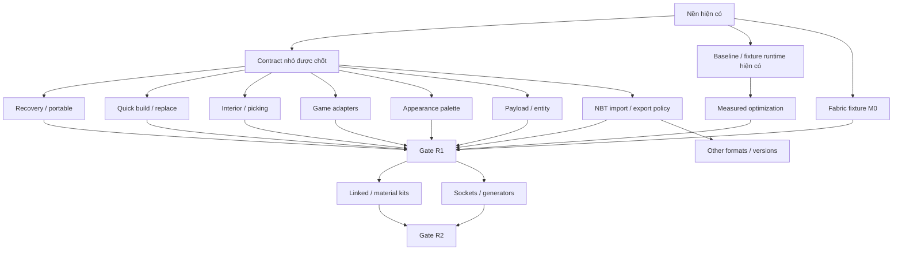

# 03 — Hiện trạng và lộ trình Blockstage Studio

Mốc đối chiếu: **30/10/2026**. Tài liệu này trả lời công cụ đang làm được gì,
bằng chứng tới đâu và nên phát triển tiếp theo thứ tự nào. Định hướng sản phẩm ở
[01_PRODUCT_GOALS.md](01_PRODUCT_GOALS.md); hợp đồng dữ liệu, kiến trúc và cách
chạy kiểm chứng ở [02_TECHNICAL_DESIGN.md](02_TECHNICAL_DESIGN.md).
Các mục tương lai dưới đây là đề xuất ưu tiên, chưa phải tính năng đã giao hoặc
ủy quyền triển khai toàn bộ. Không dùng phần trăm hoàn thành cho các phạm vi khác nhau.

## Cách đọc trạng thái

| Trạng thái | Ý nghĩa |
| --- | --- |
| **Đã có** | Có đường thao tác hoặc module hiện hành; giới hạn được ghi cùng mục. |
| **Một phần** | Đã có nền hoặc một tập adapter; chưa đủ workflow/mức tương thích mong muốn. |
| **Chưa triển khai** | Chưa có khả năng tương ứng trong editor hiện tại. Code legacy không tự được tính là UI mới. |
| **Chưa kiểm chứng** | Chưa có bằng chứng cho môi trường hoặc mức cam kết nêu ra; có code không làm đổi trạng thái này. |

Nguồn trạng thái là source hiện tại và các kiểm chứng local đã được ghi nhận.
Lượt rà soát lộ trình đọc source/evidence và nguồn chính thức; **không chạy lại
code gate, browser hoặc game oracle**. Kết quả bên dưới là bằng chứng của mốc
triển khai, không phải kết quả chạy mới trong lượt nghiên cứu tài liệu.

## M0 — Nền đã triển khai

| Khả năng | Trạng thái hiện tại và ranh giới |
| --- | --- |
| Bốn workspace | **Đã có:** Architecture, Component Editor, 3D Preview chỉ đọc và Assets. Architecture/Component có document, selection và history riêng. |
| Resource pipeline | **Đã có:** nhập ZIP/JAR qua worker, giới hạn input/work, fingerprint, bật/tắt/ưu tiên/xóa pack, xem texture, IndexedDB; lưu thành công trước publish. Pack/profile do người dùng cung cấp. |
| Registry/profile | **Đã có cho vanilla 26.2/4903:** 1.196 block, 158 entity types, 14 creative tab, tags, legal string properties và 358 model layers trong profile đã trích. Registry không bảo đảm render/export mọi loại. |
| Block appearance | **Một phần:** JSON/UV/animation và chest bindings; thêm static base-color standing/wall banners và inactive conduit từ game layers. Thiếu runtime effects/patterns/payload có reason rõ, chưa pixel parity toàn game. |
| Entity appearance | **Một phần:** source hiện có **28 binding tĩnh tường minh**, chỉ hiện model khi có layer và texture phù hợp. Assets có preview/yaw; không có animation, equipment, runtime variants hoặc AI. |
| Entity trong editor v2 | **Một phần ở dữ liệu:** giữ/render entity đã nhập qua JSON, xuất tập adapter hữu hạn. **Chưa có** workflow UI đặt/chọn/sửa entity trong Architecture/Component; không coi preview Assets là entity editor. |
| Logical multi-block | **Đã có:** bed/door/tall plant được tạo đủ phần, chọn/xóa/transform nguyên object; pair thiếu/lệch bị từ chối. Footprint dùng cell, không dùng mesh bounds. |
| Selection/transform | **Đã có:** Select/Shift, box-through, Move/Y Rotate gizmo, numeric G/R, Global/Local, object/selection/individual pivots. Move nguyên ô, whole-object yaw bội 90°, legal state đi cùng tọa độ. Parity sai bị chặn. |
| State Inspector nhiều đối tượng | **Đã có trong scope hữu hạn:** common legal fields/values, Mixed + indeterminate, atomic rewrite/validation/history cho block/multi-block. Same-ID và 6 cross-ID semantics; không flatten group/component, không neighbor simulation. |
| Preview và history | **Đã có:** preview/cancel tách document; commit atomic; collision chặn toàn command; Undo/Redo bằng object patch có giới hạn. Camera và asset preview không ghi history công trình. |
| Groups/components | **Đã có:** group/ungroup giữ children; lưu selection thành component, sửa trong Component Editor, nhập/xuất/xóa component asset và đặt lại. Instance là **bản sao độc lập**, chưa linked update. |
| Design placement | **Đã có:** giữ explicit palette state, thêm đủ parts của multi-block; yaw ghost 90°, Esc hủy. Preview và commit dùng cùng placement plan. |
| Context placement | **Một phần:** 46 log/wood/stem/hyphae/bamboo IDs, 68 slabs, 64 stairs, bed/door; thêm 9 chain axis và 10 lantern hanging trên/dưới. Side lantern giữ state + note; không alternate attachment/fluid simulation. |
| Support diagnostics | **Một phần:** door, bảy terrestrial doubleplants; thêm lantern/soul lantern khô với stone/9 chain khô. Có vị trí/unknown, cập nhật khi edit/Undo; không hard-block Design/export vì world đích có thể cung cấp support. |
| Navigation | **Đã có:** MMB orbit, Shift+MMB pan, zoom, numpad/projection, Home/frame, fly, nút view trên màn hình và trực giao X/Y/Z. Fly chưa collision. |
| Lưu và JSON | **Đã có:** Save/Ctrl+S, Documents quản lý Saved/Recovery/Storage/Backup; autosave draft riêng, explicit restore/discard. Portable v1 gồm một document + optional library copies + resource manifest, fresh-ID atomic restore và compatibility report. JSON v2/v1 import cũ giữ nguyên. Chưa linked/payload bundle hoặc merge; không bảo đảm chống mọi crash/eviction. |
| Export game | **Đã có trong phạm vi hữu hạn:** preflight, Structure NBT gzip và datapack ZIP từ snapshot đã commit; writer dùng chung với v1. Giới hạn **48 mỗi chiều** là chính sách sản phẩm, không phải giới hạn bản thân NBT. |
| Export semantics | **Đã có:** flatten cells group/component, normalize block/entity cùng vector; air tường minh xóa ô đích, sparse gap giữ ô đích. Chặn state/pair/occupancy/target sai, block entity thiếu payload và entity ngoài adapter. |
| Runtime/resources | **Đã có nền:** effective asset index, cache/lifecycle GPU, viewport tải riêng, render theo thay đổi; animation chạy khi cần. Commit base scene vẫn rebuild batch; chưa dirty-chunk incremental toàn luồng. |

Source chính để kiểm tra lại: [App](../src/App.tsx),
[EditorWorkbench](../src/ui/EditorWorkbench.tsx),
[editor session](../src/editor/useEditorSession.ts),
[document model](../src/editor/model.ts),
[placement plan](../src/editor/placement-plan.ts),
[support](../src/editor/support.ts),
[entity bindings](../src/render/entities.ts),
[export preflight](../src/io/editor-export.ts) và
[structure writer](../src/io/structure.ts).

Số binding ở đây đếm trực tiếp source hiện hành (có `parched`); số 27 trong báo cáo
cũ không còn là số đếm chính xác của bảng binding. Binding renderer và danh sách
entity export là hai tập riêng; export hiện nhận 26 loại với NBT cơ bản.

## Bằng chứng và giới hạn xác nhận

| Bằng chứng đã ghi nhận | Điều được xác nhận | Không suy rộng thành |
| --- | --- | --- |
| Code gate: **202/202 test, 19 file**, typecheck/lint/build đạt khi có tài nguyên/oracle local | Regression domain, placement, resources, renderer, export và build ở mốc triển khai | Checkout không có JAR/profile/oracle vẫn chạy cùng số test game; các test phụ thuộc game có thể skip |
| Native Edge smoke trên dev và production; layout **620×800** | Resource import/precedence/persistence, navigation, editor selection/gizmo/numeric, workspace isolation, JSON/save/reload, export download, Context actual ray/click/keyboard | GPU FPS thật, mọi thiết bị nhập hoặc mọi kích thước màn hình |
| Multi-block class oracle: **47 family bindings** | Pair offsets, yaw, một số age/property boundaries trong classes 26.2 | Player placement hoặc survival trong world |
| Placement world oracle: **126 contexts**, **102 survival fixtures** | Real ServerPlayer/BlockPlaceContext, derived fields của adapter; soil/floating-bed cases đã chọn | Full state placement, hinge, neighbor/fluid/power hoặc survival mọi block |
| Browser room → NBT/ZIP → vanilla world: **264/264 cell, 9×5×9**, trước/sau **20 tick** | Hai đường file thực sự resolve/load/đặt được và giữ state của fixture phòng | Mọi thiết kế hợp lệ trong editor đều tồn tại sau tick |
| Fixture export riêng: **152 cell, 15×3×9, một pig**, trước/sau 20 tick | Air-clear/sparse-gap, group/component/pairs, entity spawn position/yaw và entity thực sự tick | Pig AI giữ nguyên vị trí, inventory/custom payload hoặc mọi entity |
| Audit model local, UV/rotation đối chiếu game classes và ảnh QA | Những case hình học/UV, resolve/bake và giao diện đã thử | Pixel parity, lighting/biome tint đầy đủ hoặc special renderer toàn bộ |
| Kiểm tra production output | Không đóng gói JAR/texture/profile chứa geometry game | Quyền phân phối game assets của người dùng hoặc asset của mọi mod |

Evidence là dữ liệu local bị Git ignore; checkout mới cần tái tạo. Các điểm truy
nguyên hữu ích, không phải file nguồn cần commit:

- `artifacts/placement-world-km8Kkk/placement-oracle.json`: placement/survival oracle.
- `artifacts/placement-room.nbt`, `.zip`, `.expected.json`: fixture phòng tải qua UI.
- `artifacts/export-world-Es55Cd/readback.json` và
  `artifacts/export-world-fB31lw/readback.json`: phòng, NBT và ZIP.
- `artifacts/export-world-JrHABj/readback.json` và
  `artifacts/export-world-N3Td6M/readback.json`: fixture 152 cell/pig;
  `invocation.json` cùng thư mục giữ hash fixture/client.
- `artifacts/editor-context-placement.png`, `editor-component-yaw.png`,
  `editor-placement-room.png`, `editor-placement-compact.png`: ảnh QA.

Các lệnh prepare, code gate, browser và world readback nằm tập trung ở
[thiết kế kỹ thuật — kiểm chứng](02_TECHNICAL_DESIGN.md). Oracle chạy trong world
vanilla cô lập; không dùng world cá nhân và không chứng minh runtime Fabric/modded.
Một fixture sunflower trên stone từng bị game phá, giúp phát hiện support sai;
fixture dương dùng dirt. Warning hiện tại không thay thế phép thử trong world.

## Khoảng trống hiện hành

### Đợt sửa lỗi tương tác/appearance — 30/10/2026

- **Code gate mới: 241/241 test, 21 file**, typecheck/lint/build đạt. Không thêm
  dependency hoặc đổi schema/storage; chưa commit/push. Cảnh báo bundle Three.js
  >500 kB vẫn là giới hạn hiện có, không được che bằng tăng warning threshold.
- Native **Chrome production smoke đạt** với JAR/profile thật; dev đã chạy smoke
  trước bổ sung culling và reproduction cận cảnh sau bổ sung culling. Gồm resource
  precedence/toggle/remove/reload, compact UI, navigation, editor/transform/history,
  export, chọn block mảnh và chain/lantern preview/commit/Undo/Redo. GPU shader probe
  kiểm frame-edge sampling và material culling của campfire; camera đứng yên vẫn
  có playback, đổi sang static asset ngừng frames. Harness dùng SwiftShader để
  kiểm chức năng, không chứng minh FPS GPU thật. Edge local không mở được DevTools
  endpoint, nên lượt này dùng Chrome đã cài. Production output không có game assets.
- Editor chọn theo occupied cell gần nhất, index chunk 16³, bỏ explicit air.
  Placement riêng chain dùng mặt ô; slab/stair giữ mặt model. Bổ sung 9 chain axis,
  10 lantern vertical hanging; support khô vanilla/soul hữu hạn. BUG-06 đã xử lý,
  BUG-05 còn side alternate attachment/fluid/support ngoài tập đã xác nhận.
- Sửa hai lỗi đã tái hiện: sprite frame-edge leakage và z-fighting giữa hai face
  đối diện trên element không độ dày. Giữ animation, model/state và entity policy;
  BUG-01 vẫn PARTIAL vì full-strip ảnh gốc chưa tái hiện với vanilla nhập mới.
- Oracle vanilla mới `artifacts/placement-world-SXa2tK/placement-oracle.json`:
  **200 contexts + 102 survival + 336 actual item-placement/readbacks**, gồm
  40 lantern placement thành công/296 từ chối, 20 tick và support removal. Chưa
  chứng minh instance Fabric/modded của người dùng.
- CPU microbenchmark local `artifacts/cell-picking-benchmark.mjs`, Node24.19,
  300 query/cảnh dense: 10k build ~2.4ms/p95 query ~0.04ms; 100k build ~27ms/
  p95 query ~0.10ms. Đây là một lần đo synthetic CPU, không phải GPU FPS, scene
  sparse worst-case hoặc input-to-display latency trong browser.

Chi tiết reproduction, ảnh và giới hạn ở [phụ lục issue](04_CURRENT_ISSUES.md).

### Đợt 2 — Batch state Inspector, 30/10/2026

**252/252 test (22 files), typecheck/lint/build đạt.** Thêm shared-state planner,
atomic batch command và Inspector Mixed/indeterminate. Same-ID fields dùng registry;
khác ID vanilla chỉ chia sẻ 6 semantics axis/facing/rotation16/waterlogged/half
top-bottom/slab-type có domains tương thích. Structural parts bị khóa; toàn
selection chứa group/component không được flatten hoặc bỏ qua ngầm.

Các regression gồm giữ fields khác, footprint/pair của beds và pitcher growth,
final occupancy khi nhiều object dùng cell vừa được giải phóng, collision rollback,
one-step Undo/Redo và no-op giữ redo. Browser scenario mới dùng outliner Shift-click,
mixed boolean native, focus, state edits, bed collision, Save/reload; ảnh
`artifacts/editor-batch-states*.png`. Native Chrome production smoke đạt với
JAR/profile thật, gồm cả các regression resource/render/placement/export cũ;
SwiftShader không phải GPU benchmark. Không đổi schema hoặc dependency; không có
claim neighbor/world mới, không mở các roadmap task lớn chỉ vì xong batch-state.

### Đợt 3 — Scene connections và special models, 30/10/2026

**262/262 tests, 25 files**, typecheck/lint/build đạt. Optional neighborRules và
dyeColors trong game profile lấy từ đúng classes/collision predicates/DyeColor
26.2; profile cũ đọc được, cần prepare:game và nhập lại JSON để bật capability mới.
Auto connections mặc định OFF theo session/workspace, bật không rewrite dự án;
edit sau đó cập nhật fence/wall/gate và neighbors qua cùng preview/commit/history.
Dynamic/missing shapes giữ explicit state với reason. Empty cell là air của scene,
không phải world đích. Chưa auto-pane/stairs, fluid/redstone/support simulation.

Actual vanilla world oracle: **521 neighbor fixtures** so state ngay sau updates
và sau 20 tick; giữ 200 placement, 102 survival và 336 lantern cases trong cùng
run. Evidence: artifacts/placement-world-YfDS9L/placement-oracle.json. Native Chrome
production smoke với tài nguyên thật đạt cho pointer place/ghost/commit, move,
delete, nested group, Undo/Redo, wall cover và policy on/off. Không phải Fabric proof.

Banner standing/wall (32 IDs) hiện base color/pose tĩnh, lấy game layers + dye
colors + đúng transform; conduit hiện inactive shell. Static partial model/notes
phân biệt khả năng còn thiếu; không patterns/cloth/active effects/payload export.
Đã xem ảnh QA resource-special-* và editor-auto-*; build không chứa game assets.

CPU synthetic preview (20 warm samples) 10k ~7.4ms cold/~5.6ms p95 warm;
100k ~81ms/~28ms. Chỉ planner, không input latency/GPU FPS. Source index cache và
sparse root overlay tránh rehash cells không đổi; placement hover validate changed
states, commit vẫn validate toàn document. Cảnh lớn vẫn cần SLO/benchmark end-to-end.
Không thêm dependency, không đổi schema project hoặc commit/push.

Ưu tiên tiếp: tái hiện full-strip bằng effective pack/state và nghiệm thu subset
trên Fabric đang chơi; sau đó recovery/autosave/portable, quick build/repeat/material,
rồi interior visibility. Không cần chờ mô phỏng toàn game hoặc mọi special renderer.

Phản ánh sử dụng cụ thể về lantern/campfire, banner/conduit, multi-selection,
connections và chain/picking nằm trong [04 — Ghi nhận lỗi thực tế](04_CURRENT_ISSUES.md).
BUG-03/04/06 đã có fixes trong scope công bố. BUG-01/02/05 còn PARTIAL; chưa đóng toàn bộ issue intake. Xem phụ lục để chọn task tiếp theo.

| Nhóm | Trạng thái phải giữ rõ |
| --- | --- |
| An toàn dữ liệu | **Một phần:** Save CAS, catalogue/delete, autosave draft, recovery, Storage health và portable v1 đã có. Fresh-origin restore, atomic rollback và stale writers được kiểm trong scope hữu hạn. D07/release acceptance chưa đầy đủ; assets phải giữ riêng, không hứa chống mọi crash/eviction. |
| Dựng hằng ngày | **Chưa triển khai:** duplicate selection trực tiếp, repeat/arrays, resize theo quy tắc, parametric wall/column/span, socket. Đặt nhiều bản component hiện có không tương đương array tool. |
| Nội thất/phân vùng | **Một phần:** fly và orthographic giúp quan sát; **chưa có** workflow chuyên cho nội thất, layers/hide roof/floor/cut/clip/local isolation trong editor v2, visible-only/lasso selection. |
| Reuse/vật liệu | **Chưa triển khai:** linked component updates/overrides và material substitution có hợp đồng tương thích. Không suy safe replacement chỉ từ tags/creative tabs. |
| Game behavior | **Một phần:** opt-in scene connections fence/wall/gate theo game predicates đã có. Chưa slab merge/player hinge, auto-pane/stairs, dynamic shapes, support tổng quát, gravity/redstone/fluid/ticks/player collision. |
| Payload/entities | **Chưa triển khai:** entity editing workflow, block-entity inventory/custom NBT, arbitrary payload preservation adapters, entity equipment/variants/animation. |
| Appearance | **Một phần:** thiếu nhiều special renderer, fluid geometry/appearance, biome tint, lighting/AO parity và một số hiệu ứng động. Sprite animation hiện có không đồng nghĩa entity animation. |
| Formats/versions | **Một phần:** import Java Structure NBT raw/gzip blocks-only 26.2/4903 đã có, registry exact state, complete pairs và report/atomic commit. Chưa nhập entity/BE payload, multi-palettes, `.schem`, `.litematic`, multi-version migration hoặc Fabric bridge. |
| Môi trường game | **Chưa kiểm chứng:** instance Fabric/modded của người dùng, ZIP bật qua UI client Fabric, command rotation/mirror, các block/state/entity ngoài fixture. |
| Hiệu suất | **Chưa kiểm chứng:** GPU Windows thật, p95 end-to-end, memory dài hạn và cảnh triệu block. Schema v2 hiện giới hạn 100.000 cells/document; benchmark 1M đòi hỏi kế hoạch dữ liệu riêng. |
| Phân phối | **Chưa triển khai:** desktop installer, cloud/AI/marketplace. Chỉ cân nhắc khi workflow thực tế cần, không là điều kiện hoàn thành editor local-first. |

Không giữ các kết luận lịch sử “chưa đọc model JSON”, “chỉ resource workspace”,
“chưa xuất v2/chưa đặt trong world” làm hiện trạng. Ngược lại, công cụ legacy từng
có delete-project, material replacement, layer/cut hoặc entity placement không có
nghĩa editor v2 hiện đã mở lại các workflow đó.

## 1. Kết quả rà soát lộ trình

Rà lại ngày **30/10/2026** bằng source, ba lượt audit độc lập và nguồn chính thức
ở cuối tài liệu. Đây là nghiên cứu/kế hoạch; chưa triển khai task mới, chưa chạy
lại test, browser, game oracle hoặc benchmark. Các mục dưới đây **thay thế** lộ
trình S1–S10, không tạo một backlog cạnh tranh với nó.

| Điểm bất hợp lý/thiếu | Điều chỉnh |
| --- | --- |
| S2/S3/S4/S9 chờ tuần tự S1 | An toàn dữ liệu là gate phát hành, không phải prerequisite của mọi module. CRUD, duplicate, view và đo baseline chạy riêng sau contract cần thiết. |
| Nội thất S4 chờ Duplicate S3 | Bỏ cạnh này: hide/isolate/clip cần visibility/picking contract, không cần copy. |
| Fabric S7 đợi mọi placement/payload | Kiểm M0 trên Fabric định danh ngay; capability mới chỉ chờ fixture của chính nó, chưa cần bridge. |
| Linked/material/parametric gộp S8 và quá muộn | Safe material replacement đưa vào R1; linked revisions, kits và sockets/generators thành các lane riêng. |
| Entity và BE payload gộp S6 | Tách schema/codec/BE khỏi entity commands/UI; thấy chest không chứng minh inventory đã bảo toàn. |
| Formats và versions gộp S10 | NBT import subset 26.2 không chờ full entity UI; `.schem`, `.litematic`, version migration có gate khác nhau. |
| Thiếu giá trị dựng nhanh | Thêm clipboard nội bộ, line/plane/box, bulk replace, block counts và portable backup. |
| Hiệu suất gần như đồng nghĩa dirty chunks | Đo validation → history → flatten/index → render/frame, save và memory; không chỉ GPU. |
| Autosave chỉ mô tả debounce | Cần revision/session epoch/CAS, draft-vs-saved, delete generation và multi-tab trước khi ghi tự động. |
| Không định nghĩa công cụ “hoàn thiện” | Hai release profile hữu hạn R1/R2, palette/capabilities/runtime rõ; không đợi mô phỏng mọi mod/game behavior. |
| Chia feature cho agent nhưng dùng chung file | Một file một owner; đóng contract trước fan-out, integrator ghép shared session/UI/schema. |

Các rủi ro tìm thấy từ source, **chưa phải lỗi đã tái hiện hoặc bottleneck đã đo**:

- `useEditorSession.save()` ghi document và preference qua hai transaction, ack
  đối chiếu ID; chưa có revision/CAS/session epoch. Cần thử overlapping Save,
  chuyển đi/quay lại cùng ID, delete và hai tab.
- Operations/session validate toàn document; history diff/serialize, Workbench
  flatten/occupancy/support, Viewport rebuild mọi batch khi blocks đổi. Chỉ tối ưu
  chunk GPU có thể vẫn để chi phí CPU lớn.
- `storage` dùng `getAll` cho mọi document/component; library component dùng
  `assets.map`. Không ghi rằng mọi library đều đã phân trang.
- History budget đếm cells, chưa tính đủ entities/metadata và payload bytes.
- Schema v2 strict chưa có payload hoặc source revision; không nhét linked/unknown
  NBT vào field tùy ý. Opaque preservation không đồng nghĩa hiểu cách transform.
- Cap 100k là giới hạn document; 1M cần thiết kế dữ liệu/work budget riêng. Export
  cap 48 lặp ở preflight/writer là policy, không phải giới hạn chung của NBT.
- Baseline nay đã có HEAD (đối chiếu lại 31/10/2026); plain `git diff` vẫn không
  đủ review untracked files. Kiểm cả status/file mới; không tự commit/reset/push.

## 2. Định nghĩa hoàn thiện theo release

R1 là bản dựng kiến trúc dùng thực tế; R2 hoàn thiện giá trị CAD module của ý
tưởng ban đầu. Mỗi release có manifest palette/format/runtime và capability theo
action, không gắn một cờ “hỗ trợ Minecraft” cho tất cả.

| Mốc | Cam kết hữu hạn | Gate chính | Chưa hứa |
| --- | --- | --- | --- |
| **R0 — Nền hiện có** | Resource → editor block/group/component copy → lưu JSON → xuất fixture nhỏ. | Bằng chứng M0 ở trên. | Recovery, dựng hàng loạt/nội thất hoặc coverage toàn bộ. |
| **R1 — Architectural Editor 1.0** | Dựng/sửa nhà hai tầng nhiều phòng; duplicate/repeat/vùng, sửa nội thất, thay vật liệu hợp lệ, lưu/phục hồi/chuyển máy và xuất game. | Recovery/portable backup; quick build; visibility/picking; component-copy library; counts; renderer palette; basic entity + một BE adapter công bố; NBT subset import/export; vanilla và một cấu hình Fabric 26.2; perf/UX gate. | Linked/parametric tổng quát, mọi renderer/NBT/entity/mod, nhiều versions, desktop/cloud/AI, triệu block. |
| **R2 — Modular Architecture 1.0** | Linked source/overrides, material roles/kits, sockets và tập wall/column/floor/roof generators hữu hạn; ba biến thể kiến trúc dùng lại. | R1 + L/A; migration opt-in/rollback, source update/regeneration giữ override/lỗ mở, game readback lại. | Marketplace, full survival simulator hoặc arbitrary mod renderers. |
| **X — Extensions** | `.schem`, `.litematic`, version tiếp theo, payload/entity đặc biệt, bridge/desktop khi có nhu cầu. | Gate riêng từng adapter/runtime. | Không có danh sách phiên bản vô hạn hoặc deadline chưa đo. |

Nếu một loại entity/BE chưa đạt thì không nằm trong coverage supported. Muốn bỏ
cả lane entity/BE khỏi R1 phải sửa release promise công khai; không đổi TODO thành
done chỉ để đóng mốc. Mục tiêu dài hạn G01–G08 vẫn giữ nguyên.

**Envelope R1 mặc định:** nhà nghiệm thu nằm trong **48 cell mỗi chiều** để dùng
export hiện có. Không hứa xuất công trình lớn không giới hạn. Nếu chọn lớn hơn,
I04 và gate pair/payload/tile/entity seams trở thành prerequisite R1 có phê duyệt.
K02 phải chốt palette/runtime và tối thiểu người nghiệm thu; P02 chốt hardware/SLO
trước đánh release READY. Thiếu participant/hardware thì giữ gate UNVERIFIED hoặc
ghi scope exception được chủ dự án chấp thuận, không tự miễn âm thầm.

Gate chung R1/R2:

1. Builder dựng nhà hai tầng từ scene rỗng, sửa và reuse mẫu, tạo ít nhất hai biến
   thể vật liệu. Phân biệt fixture JSON nhập sẵn với workflow builder thật.
2. Chọn/sửa nội thất không phá mái/tầng ẩn; view state không thay dữ liệu export.
3. Cancel/collision/Undo/Redo giữ IDs/cells/pair/state/payload theo contract.
4. Reload/lỗi lưu/quota/hai tab/import sai/chuyển origin/máy có kết quả rõ; backup
   không phụ thuộc DB cũ và không chứa game assets. Không hứa chống mọi mất điện.
5. File/game readback đối chiếu độc lập trên palette/runtime công bố; fingerprint
   loader/mod/client/profile và placement policy rõ; unsupported không bỏ ngầm.
6. Đo scene 1k/10k/100k dense/sparse/mixed, cold/warm trên máy/GPU/driver/browser
   xác định. Ít nhất 30 mẫu sau warmup cho p50/p95 khi khả thi. Mục tiêu thử ban
   đầu: picking/preview p95 <50 ms, edit-to-visible p95 <100 ms ở 10k; **chưa đạt
   và chưa được coi là cam kết**, P02 phải đo/chốt lại. 100k báo envelope riêng;
   1M nằm ngoài R1/R2.
7. Quan sát 3–5 phiên builder khi có thể, gồm chủ dự án: task success, thời gian,
   lỗi, trợ giúp cần; đây là usability ban đầu, không chứng minh hơn mọi đối thủ.
   Có keyboard/focus/error recovery và kiểm màn hình 620px.
8. Relevant code/browser/game gates đạt; capability/docs khớp source; không có
   control giả, game assets/secrets trong package hoặc compatibility claim thiếu proof.

## 3. Work packages và quan hệ thật

**P0** an toàn, **P1** R1, **P2** R2, **X** extension. Gate phát hành khác dependency
để viết code: planner Duplicate có thể song song repository, release vẫn chờ recovery.

| WP | Đầu việc lớn | Mốc / mục tiêu | Có thể chạy riêng |
| --- | --- | --- | --- |
| K | Baseline + contracts revision/operation/view/capability/import | P0; G01/G03/G06/G07 | Chốt từng interface nhỏ, không thiết kế hết tương lai. |
| D | Repository, draft/recovery, project catalogue, portable backup/quota | P0/R1; G07 | Repo/controller/UI có owner khác, UI tích hợp sau. |
| B | Duplicate/clipboard/repeat, line/plane/box, safe replace/counts | P1/R1; G03/G04/G05 | Pure planners và read-only report không chờ recovery UI. |
| V | Hide/lock/isolate/clip, picking/frame và interior camera | P1/R1; G03/G04/G08 | Sau visibility contract, không chờ B. |
| G | Capability registry và family world/state adapters | P1 theo palette; G01/G06 | Oracle trước implementation từng family, không simulator. |
| R | Appearance coverage/resources/render lifecycle | P1 theo palette; G01/G08 | Tách geometry/fixtures khỏi placement rules. |
| N | Typed NBT/BE lane + entity commands/UI lane | P1 subset; G02/G06/G07 | Hai lane khác nhau, một schema owner. |
| I | NBT subset import, shared export policy, formats/versions | P1 rồi X; G07 | Codec/report không chờ full entity UI. |
| L | Copy library UX, linked revisions/overrides, material kits | Copy P1, linked/kits P2; G02/G05 | Copy UX/kit không bắt buộc linked. |
| A | Socket solver và bounded generators/regeneration | P2; G04 | Có thể sinh baked copies trước linked. |
| P | End-to-end measurement/CPU/GPU/memory optimization | Bắt đầu ngay, gate R1/R2; G08 | Đo trước, chỉ tối ưu bottleneck có evidence. |
| Q | Runtime/Fabric/fixtures/CI/UX/integration/release | Xuyên suốt; G01–G08 | Fabric M0 ngay; capability mới chờ adapter tương ứng. |



Sơ đồ là gate release, không bắt nghiên cứu L/A chờ R1 đóng. Task dependencies
bên dưới mới là cạnh implementation; contract có thể được chốt dần.

## 4. Task catalogue giao subagent

Danh mục hiện gồm **12 work packages, 97 task**, dependency graph 199 cạnh không
chu trình ở lần kiểm tài liệu này. Đây là kiểm tra cấu trúc kế hoạch, không chứng
minh task đã được triển khai hoặc thời gian hoàn tất. Đọc §5 để chọn wave đầu,
không giao toàn bộ catalogue cùng lúc.

**Task mặc định TODO**, trừ phần đã ghi nhận dưới đây. `—` chỉ cần nền M0. Dependency phải đã tích hợp/review,
không chỉ agent báo xong. Path mới dưới đây là **dự kiến** để phân ownership, chưa
tồn tại hoặc chưa được quyết định. Integrator giữ shared UI/schema/session.
Mỗi dòng là đầu ra review được; dòng ghi rõ “chia theo family” phải tách ID con
trước khi giao, không đưa nguyên cả hệ thống cho một agent.

### Tiến độ triển khai — 31/10/2026

- **D01 VERIFIED trong scope repository editor hiện tại:** IndexedDB v6 thêm
  revision sidecar, không rewrite records v5; đọc legacy, bỏ qua và báo record sai,
  Save CAS + snapshot/revision/preference atomic, remove CAS + tombstone.
  Đường Save hiện tại đã dùng repository, epoch/snapshot ack và báo conflict giữ
  local edits; không bypass CAS qua storage API cũ. Không có dependency mới.
- **K04 subset repository REVIEWED**, **K07a một phần** ở mốc D01. Revision và
  controller bổ sung ở D02/D03 bên dưới. K02/K03/K05/K06 vẫn TODO; không đánh
  VERIFIED toàn bộ operation/persistence contracts từ một slice.
- Kiểm chứng: code gate **262/262 test, 25 file**, typecheck/lint/build; native
  browser dùng hai connection IDB độc lập, Save đảo thứ tự, tombstone chống
  resurrection, rollback lỗi quota giả lập, upgrade v5/abort giữ dữ liệu và invalid
  records không bị ghi đè. Production UI kiểm Save/Undo/reload và edit-during-await,
  conflict giữ local data. Đây chưa phải hai tab app/live invalidation hoặc
  crash recovery/quota thật; D07 vẫn TODO. Smoke script tự bundle fixture riêng
  trong memory, không thêm test code/game assets vào bản phân phối.
- **D04 catalogue v2 VERIFIED:** nút Documents, tìm/lọc workspace, mở/rename/delete
  đúng ID kể cả trùng tên, metadata version/cells/date, explicit discard có/không
  Saved base; cancel và lỗi storage giữ dữ liệu. New pristine không tích tụ Saved,
  Save rỗng chủ động được giữ, Untitled có nội dung được bảo vệ khi chuyển.
  Active delete reset history/selection/preference, không cascade assets/copies.
  Working component IDs độc lập, source binding qua reload nằm trong sidecar.
- Browser production bổ sung Open/rename active/inactive, Undo/discard, delete
  failure giả lập, compact **620×800**, xóa rồi sửa lại component/library publish;
  hai app pages cùng origin kiểm stale delete và peer Save không resurrect ID.
  Đây là conflict rejection, chưa phải live invalidation/merge hay recovery.
  Evidence tái tạo bằng `test:browser`; ảnh `artifacts/editor-documents.png` và
  `artifacts/editor-documents-compact.png`. K07b seam đã có DocumentManager nhận
  props/callbacks; K07a vẫn chưa có draft controller/committed revision.
- **D02/D03 VERIFIED trong scope draft recovery v2:** IndexedDB v7 thêm heads/payload stores, không
  rewrite Saved v5/v6. Local revision tăng qua Undo/Redo; savedRevision và storage
  token độc lập. Controller debounce 750ms/max delay 5s, latest coalescing, stale
  ack rejection, pause/drain trước IO, retry thủ công sau lỗi và cleanup timers.
  Autosave chỉ bảo vệ draft, không publish Saved hoặc camera/preview. New/Open
  flush recovery thay save-before-switch; failed protection giữ document đang mở.
- Documents → Recovery có Restore/Recover copy/download JSON/discard. Saved base
  đã đổi thì Restore bị chặn; copy ID mới bỏ library publication binding. Save
  retire own stream atomic, Delete document retire mọi stream; tombstone chặn
  callback đến muộn. Giới hạn 32 live drafts/64 MiB tổng/32 MiB mỗi snapshot;
  reject overflow, không tự xóa dữ liệu. BroadcastChannel/focus/Refresh invalidation
  không thay CAS và không phải merge. Tab nền có thể throttle, pagehide best effort.
- Code gate mới **270/270 test, 26 file**, gồm 8 controller tests với fake clock;
  typecheck/lint/build đạt. Native IDB fixtures kiểm stale Save/discard/load,
  delete nhiều stream, rollback/quota giả lập, capacity/aggregate byte accounting,
  payload sai giữ nguyên, copy/resume binding, upgrade v6→v7 không rewrite.
  Byte budget aggregate dùng metadata fixture; không coi là memory benchmark.
- Full production browser suite đạt cùng tài nguyên 26.2 local: resources,
  placement/export/state/neighbor, Save, Documents và Recovery đều pass. Recovery
  kiểm reload offer/restore, download JSON, Saved base giữ nguyên, Undo/Redo tăng
  revision, Architecture/Component độc lập, đóng page rồi phục hồi, lỗi quota giả
  lập + latest retry, changed-base copy, hai app pages delete vô hiệu hóa mọi draft,
  phục hồi thiếu pack/profile và compact 620×800. Ảnh đã xem:
  `artifacts/editor-recovery.png`, `artifacts/editor-recovery-compact.png`.
  Không thử tắt nguồn/kill browser hoặc disk quota thật; không suy thành bảo đảm
  mọi crash hay fresh-origin portable restore. D07 vẫn một phần.
- **D06 VERIFIED trong scope Storage health:** Documents → Storage đã có probe usage/quota/persistence,
  opt-in request, Refresh, unsupported/denied/error/timeout và hướng dẫn JSON backup.
  Không scan/ghi/xóa IDB, không đổi project/history; không thêm dependency/schema.
  Ưu tiên D06 trước D05 vì dependency D01 đã có; D05 cần freeze K06 manifest/restore.
  Code gate **277/277 test, 27 file**, gồm 7 storage-health tests (partial APIs,
  invalid estimates, independent failures, request coalescing, denied/error/timeout).
  Browser probe native read-only + injected permission cases, không giả granted
  permission thật hay disk quota stress. D07 còn acceptance portable/fresh-origin.
  Full production browser suite đạt (resource/editor/export/Documents/Recovery);
  Storage kiểm mọi IDB store và snapshot document trước/sau giữ nguyên. Đã xem
  ảnh `artifacts/editor-storage-health.png` và `editor-storage-health-compact.png`
  (620×800); screenshots quota cao dùng injected estimate, không phải dung lượng
  thật của máy. Không có game assets trong production output.
- **D05a/D05b VERIFIED cho bundle v1/copies hiện tại:** Documents → Backup có
  download/open/report/ack/cancel/Restore as new. Một document v2, optional toàn
  bộ component library và ordered resource hashes; không chứa game assets/profile
  geometry. K06 subset JSON/copy-boundary freeze ở kỹ thuật §4.5; typed NBT/linked
  closure vẫn TODO, không coi mọi K06/N/I contracts đã hoàn tất.
- Bundle max 32 MiB JSON, 256 definitions, aggregate 100k cells/objects và bounded
  parse work/depth. Unknown string states giữ nguyên kèm report, unknown payload/
  fields/version reject. Fresh IDs/remap source provenance, không publication link;
  add document/revision/library/preference atomic, quota/conflict rollback.
- Code gate **284/284 test, 28 file**, typecheck/lint/build và fixture typecheck đạt.
  Production full browser suite pass. File thực tải từ UI → origin khác **localhost
  so với 127.0.0.1**, trống DB/packs/profile → report + acknowledgement → restore →
  reload → UI JSON download so exact restored document; group/log axis/bed pair/
  fractional entity data và library copies giữ nguyên. Reimport tạo bản sao mới,
  cancel/malformed/quota giả lập không mutation. Native IDB thêm atomic rollback
  document/revision/assets/pointer và ID conflict rejection. Đã xem ảnh
  `artifacts/portable-source-backup.png`, `artifacts/portable-import-compact.png`.
  Build không chứa assets, không thêm dependencies/schema DB.
- **Tiếp theo:** D07 còn audit fault/fresh-origin coverage và release workflow;
  quota thật, browser kill/power loss và toàn bộ journey R1 chưa VERIFIED. Recovery
  vẫn thuộc origin; portable file chỉ giúp khi người dùng tải và giữ file ngoài
  browser. Chưa backup mọi workspace/recovery hoặc linked/payload data; mở lại gate
  portable khi N06/L bổ sung schema. Sau gate dữ liệu, chọn slice quick-build theo DAG.

### Slice bổ sung theo yêu cầu — import `.nbt` trong phiên

- **Đã có cho subset blocks-only:** Import NBT trên toolbar, raw/gzip Java named
  big-endian NBT, DataVersion 4903, single palette, registry-validated strings,
  complete logical multi-blocks, explicit air khác sparse gap. Worker cancel/timeout,
  decompressed/work/depth limits; reject entities/BE payload/multiple palettes/
  unknown fields/version, không drop dữ liệu. Author/border-size limitation có
  report/ack. Import tạo Saved mới atomic sau bảo vệ draft hiện tại.
- **293/293 test, 29 file**, typecheck/lint/build đạt. 9 tests mới: raw/gzip,
  writer subset roundtrip, bed/door/stairs/slab/log state, air/sparse, missing/
  illegal registry, duplicate/out-of-bounds/index, payload/version, truncation/
  trailing data/CRC/decompression cap, long precision và Java modified UTF-8.
- Full production browser suite đạt cùng fixture NBT tạo bởi builder độc lập:
  raw/gzip report/cancel, payload/version reject, worker actual load, lỗi transaction
  giả lập giữ scene cũ, Saved import/reload/JSON, export preflight/download và 620px.
  Ảnh `artifacts/nbt-import-report.png`, `artifacts/nbt-import-compact.png` đã xem.
  Giao diện dialog tự tải CSS riêng, không phụ thuộc đã mở Documents trước đó.
  Lượt xác thực lại sau phiên gián đoạn: `pnpm check` vẫn đạt 293 tests;
  browser slice `nbt` đạt toàn bộ các bước trên, đã xem lại ảnh compact sau reload.
- I01/I02/I03 và N01 **chỉ một phần**, không đánh VERIFIED nguyên milestone:
  entity-only/payload/format variants và independent **world** roundtrip của file
  import chưa có. Reader TAG1–12 không đồng nghĩa payload editor/lossless writer.
  Đây không là full game/version conversion. Import envelope ≤2048/dimension,
  100k explicit cells, 16 MiB input/32 MiB giải nén; export cap48 vẫn giữ. Không
  thêm dependency, không thay document/DB schema, không commit/push.

### K — Hợp đồng và baseline

| ID | Đầu ra / phạm vi ghi dự kiến | Phụ thuộc | Nghiệm thu |
| --- | --- | --- | --- |
| K01 | File/hash manifest, tracked/untracked/deleted scope; integrator. | — | Snapshot review được, không giả có HEAD; checkpoint Git khi user yêu cầu, không reset/commit ngầm. |
| K02 | Capability/fixture contract, palette R1; `src/core/capabilities.ts`. | — | Tách registry/render/place/transform/payload/formats/world-proof, mỗi action có reason/evidence. |
| K03 | Operation plan types: base revision, deterministic IDs, changed IDs/cells/chunks, budget/cancel; kỹ thuật §10. | — | Add/replace/remove/undo rõ; stale plan reject; reuse history hiện có, không command framework mới. |
| K04 | Persistence state table: revision/session epoch/CAS/saved/draft/delete generation; kỹ thuật §10. | — | Async writes đảo thứ tự, quay lại cùng ID, undo sau Save, hai tab/quota/delete có kết quả rõ. |
| K05 | Visibility/picking matrix owner/cell; kỹ thuật §10. | — | Draw/click/hover/box/frame/ghost/export, hidden selection, locked và partial clip rõ. |
| K06 | Typed-payload/import/portable boundary và migration policy; kỹ thuật §10. | — | Preserve/reject/quarantine, typed longs/UUID/position, limits, unknown state/profile và version rõ. |
| K07a | Session command/repository adapter seam; integrator giữ hook, không viết lại repository của D01. | K03, K04 | Operation revision và save/draft interfaces rõ, M0 parity; chỉ extract khi consumer cần. |
| K07b | UI panel/shell seam; integrator giữ Workbench/App, module panel nhận props độc lập. | — | Không nhét luật game vào React; giữ keymap/focus/M0, chưa phụ thuộc view/repo contract không liên quan. |
| K07c | Viewport visibility/picking interface seam; một viewport owner. | K05 | Draw/pick/frame dùng interface đã chốt, không đổi document hoặc rewrite renderer. |

### D — Quản lý dữ liệu, vòng đời bản nháp và phục hồi

Ưu tiên UX mới từ **BUG-07** trong [issue intake](04_CURRENT_ISSUES.md): Open saved
tích tụ Untitled component nhưng chưa có cách xóa. Đây là saved editor documents,
khác component assets; save-before-switch có thể persist cả placeholder. Đưa quản
lý/xóa/discard vào scope đầu milestone, không chờ bật autosave rồi mới dọn danh sách.
K04/D01 phải chốt identity/delete guard trước; D04 có thể làm UI catalogue song
song D02/D03 sau khi contracts được review. Không thêm dependency vòng D02↔D04.

| ID | Đầu ra / phạm vi ghi dự kiến | Phụ thuộc | Nghiệm thu |
| --- | --- | --- | --- |
| D01 | `src/io/editor-repository.ts`, CAS/revision và fault seam tests. | K04 | Read+compare+write trong transaction, snapshot/metadata/pointer atomic khi cần; stale/abort không publish Saved. |
| D02 | `src/editor/draft-controller.ts`, debounce/coalesce/cancel/ack/retention tests. | D01 | Edit trong await không mất latest revision, session cũ không ghi sang doc mới, preview không autosave. |
| D03 | Recovery/status panels + session wiring; integrator. | D02, K07a, K07b | Saved khác Draft; Restore/Discard; new chưa Save/reload/quota, Architecture/Component độc lập. |
| D04 | Document catalogue/list/rename/open/delete, phân biệt Draft/Saved và library assets; BUG-07; module/panel riêng. | D01, K07a, K07b | Xóa đúng ID kể cả trùng tên; discard không xóa checkpoint/asset; New rỗng không tích tụ Saved; active doc/preference đúng, transaction lỗi giữ mục; pending Save/autosave không resurrect; undo edit không undo IO delete. |
| D05a | Versioned portable backup codec/manifest; document, definitions và resource/profile hashes. | K06 | Codec roundtrip không DB cũ; thiếu assets báo; không nhúng Mojang assets; linked sau này có dependency closure. |
| D05b | Download/import backup panel + report/explicit commit; integrator wiring. | D05a, K07a, K07b | Fresh origin restore từ file qua UI, chọn resolve missing refs; cancel không mutation, không giả codec đã thành workflow. |
| D06 | Storage health/quota/persistence opt-in controller. | D01 | Handle denied/absent/QuotaExceeded; persist không thay backup; không xóa user project để dọn cache. |
| D07 | Fault/multi-tab/fresh-origin browser suite; verifier + integrator. | D03, D04, D05b, D06 | Async old/new/delete/two-tabs, failed draft và malformed records; UI ack đúng, legacy giữ nguyên. |

D04 viết module không cần đợi xong D03; integration cuối phải xét draft semantics.
Gate D phải thử delete/discard trước khi autosave mặc định bật: không tự xóa bản
Untitled hoặc rỗng hiện có, không nhầm Remove component với Delete document;
reload/hai tab/stale callbacks không khôi phục mục vừa xóa. Chi tiết ở BUG-07.
D05a bắt đầu bằng snapshot/copy v2, không bắt buộc chờ linked hoặc payload editor.

### B — Dựng nhanh

| ID | Đầu ra / phạm vi ghi dự kiến | Phụ thuộc | Nghiệm thu |
| --- | --- | --- | --- |
| B01 | `src/editor/duplicate-plan.ts` + tests. | K03 | Fresh nested IDs, group/pair/component copy đúng, source nguyên vẹn; collision/budget chặn cả action, một Undo. |
| B02 | Internal clipboard envelope/anchor/paste planner. | B01, K06 | Copy không mutate, paste nhiều lần IDs mới, âm/pivot/pairs đúng; system clipboard chưa bắt buộc. |
| B03 | Repeat axis/count/spacing planner. | B01 | Budget trước expand, collision giữa copies, count/zero/negative policy rõ; cancel không mutation. |
| B04 | Line/rectangle-plane planner, dimensions/anchors. | K03 | Inclusive endpoints/grid rõ, unique cells, overflow/collision/pairs đúng policy; preview bounded. |
| B05 | Solid/hollow box planner. | B04 | Cạnh chung không trùng, hollow đúng, dimensions biên/1/0/âm; không float-scale hoặc giả parametric resize. |
| B06 | Selected material replacement + compatibility report; `material-plan.ts`. | K02, K03 | Legal properties/pairs/payload policy, log→log giữ axis; incompatible reject, tags không thay proof; một Undo. |
| B07 | Read-only placed block/state counts + CSV/JSON, module/panel riêng. | K02 | Phân biệt cells với survival items: bed/door hai cell không mặc định hai items; acquisition chưa có rules phải ghi rõ. |
| B08 | Duplicate/clipboard/repeat numeric/pointer/keyboard integration. | B01, B02, B03, K07b | Phím không đụng Place R, ghost/cancel/undo/redo/source parity có browser proof. |
| B09 | Primitive/replace/count panels và house workflow integration. | B05, B06, B07, K07b | Dựng/sửa phòng từ rỗng không cần JSON, hai material variants, params/context gọn và selection scope rõ. |

### V — Nội thất và selection

| ID | Đầu ra / phạm vi ghi dự kiến | Phụ thuộc | Nghiệm thu |
| --- | --- | --- | --- |
| V01 | `src/editor/view-state.ts` selectors/tests. | K05 | Hide/lock/isolate ngoài document/history, per-workspace state và reset rõ. |
| V02 | Draw/pick/box/frame/hover visibility integration; một viewport owner. | V01, K07c | Hidden/locked/partial clip đúng matrix; multi-block vẫn logical whole; fallback không bypass picking. |
| V03 | Clip plane/Y-range và roof/floor helpers; viewport owner. | V02 | Clip không chỉ shader ẩn: ray/box theo policy; export không đổi cells. |
| V04 | Hide/isolate/clip/reset-visible panels; integrator. | V03, K07b | Sửa trong phòng kín, không nhầm scope; có keyboard/nút và usable 620px. |
| V05 | Interior camera near/speed/eye-height/frame fixture. | K05 | Phòng hẹp/door không làm mất view, không history; không gọi fly là collision/gravity simulation. |
| V06 | Visible-only selection spike rồi implement theo kết quả. | V02, P02 | Occlusion/transparency/partial owner policy và fixture; through mode giữ nguyên. |

V06 có thể sau R1 nếu click+through+hide đủ hoàn thành interior gate; giới hạn phải công bố.

### G — Capability và quy tắc Minecraft

| ID | Đầu ra / phạm vi ghi dự kiến | Phụ thuộc | Nghiệm thu |
| --- | --- | --- | --- |
| G01 | Versioned adapter capability registry + class provenance. | K02 | Hợp nhất runtime allowlists trùng, giữ oracle độc lập; per-action evidence, không suy suffix/tag. |
| G02a | Slab merge oracle fixture. | K02 | Top/bottom/double, hit thay thế vs adjacent, same/different material và waterlogged; default/strict game policy rõ. |
| G02b | Stair-neighbor oracle fixture. | K02 | Inner/outer/straight, facing/half và boundary unknown; expected độc lập planner. |
| G02c | Fence-connection oracle fixture. | K02 | Post/side/state/các loại neighbor, explicit air và destination unknown, before/after update. |
| G02d | Pane-connection oracle fixture. | K02 | Transparent/mixed neighbors và hướng N/E/S/W, dương/âm/biên. |
| G02e | Wall-connection oracle fixture. | K02 | Tall/low/up và support/cross geometry theo state, game update policy rõ. |
| G02f | Door-hinge oracle fixture. | K02 | Click side, neighbor solid/door, upper/lower, facing và powered; không giả cả state từ palette. |
| G03a | Slab merge planner; module riêng. | G01, G02a, K03 | Replace/remove bounded, complete logical owner, waterlogged policy; Undo gồm thay đổi cũ; cancel nguyên vẹn. |
| G03b | Stair-neighbor planner; module riêng. | G01, G02b, K03 | Neighbor patches bounded, cycle/unsupported outcome rõ; Design không tự sửa shape khi chưa opt-in. |
| G04a | Fence adapter; module/test riêng. | G01, G02c, K03 | World readback/history parity, affected neighbors/collision atomic. |
| G04b | Pane adapter; module/test riêng. | G01, G02d, K03 | Cùng fixture, không mutate ngoài policy và unknown boundary rõ. |
| G04c | Wall adapter; module/test riêng. | G01, G02e, K03 | Tall/low/up đúng, runtime comparison trước mở coverage. |
| G04d | Door-hinge adapter; module/test riêng. | G01, G02f, K03 | Tạo đủ pair, open/powered policy rõ và matching hit/neighbor fixtures. |
| G05 | Support coverage cho palette R1 + diagnostics. | G01 | Thêm oracle đúng từng support rule trước implementation; bed floating đúng, unknown/fluid rõ; không suy missing thành air. |
| G06 | Yaw/mirror/state/payload transform matrix và adapter tests. | G01, K06 | 4 yaw/2 mirror identity, facing/axis/rotation/hinge/pair/shape cùng cell; unsupported không quay mesh giả. |
| G07 | Ghost/resolved-state/export capability integration. | G03a, G03b, G05, K07a, K07b | Cùng plan/patch; error-vs-warning rõ, không nửa object, R1 chỉ bật family VERIFIED; G04a–d ghép riêng khi đạt. |

G06 có thể tách tiếp theo transform khi discovery xác định coverage. Các G04a–d
có thể sau R1 nếu không nằm trong manifest. Full survival, redstone và
fluid propagation nằm ngoài R1/R2. Bộ rules không thay matching runtime oracle.

### R — Appearance/resources

| ID | Đầu ra / phạm vi ghi dự kiến | Phụ thuộc | Nghiệm thu |
| --- | --- | --- | --- |
| R01 | Palette appearance fixture harness và coverage/hash/ảnh report. | K02 | Cube/log/slab/stair/bed/door/glass/leaves/connected/BE/entity; same state/pack/camera game, không commit assets. |
| R02 | Sửa một lỗi geometry/UV/alpha/transparency/culling ưu tiên đã tái hiện; nhân task R02.x cho lỗi khác. | R01 | Regression + ảnh đối chiếu chính case fail, override không đổi doc; không hứa pixel parity mọi block. |
| R03 | Preview biome tint/light context hữu hạn. | R01 | Environment label rõ, appearance không sửa world metadata, không giả game simulation. |
| R04 | Static fluid/waterlogged appearance theo fixture. | R01 | Geometry/state coverage rõ; không gọi là flow simulation, unsupported vẫn reason. |
| R05 | Missing resource/profile relink UI và thumbnail jobs. | K02, D05a | Hash/precedence rõ, missing refs recoverable; cancel/dispose thumbnail, không rebuild scene chính. |
| R06 | Context-loss/cache/disposal/pack-switch regressions. | R01, K07c | Recreate giữ doc, callback/job cũ không ghi resource mới; repeated switch/import/delete không giữ GPU objects vô hạn. |

R03/R04 quyết theo palette release. Renderer support không tự mở game export.
Không cần mọi entity animation/equipment để đạt một palette kiến trúc hữu dụng.
R02 có thể NOT-NEEDED nếu R01 không có lỗi blocking; reviewer duyệt evidence, không
tạo bugfix giả để mở release. Q05 chờ coverage R01 và mọi R02.x blocking được đóng
hoặc có scope exception; R06 chạy ngay trên baseline, không chờ phát sinh lỗi geometry.

### N — Typed payload và entities: hai lane riêng

| ID | Đầu ra / phạm vi ghi dự kiến | Phụ thuộc | Nghiệm thu |
| --- | --- | --- | --- |
| N01 | `src/io/nbt-codec.ts` typed bounded binary reader/writer. | K06 | Byte/short/int/long/float/double/list/compound/arrays, longs không mất precision, Unicode/NUL, limits/malformed/truncation và independent reader. |
| N02 | Payload ownership/schema opt-in và legacy migration/report; schema owner. | N01, K03 | Unknown reject hoặc opaque/read-only có lý do; JSON/save/copy/delete giữ types, transform không hiểu phải chặn. |
| N03 | BE chest adapter cho empty/nonempty inventory trong scope vanilla đã công bố; module riêng. | N02, G01 | Per-cell/position policy, item payload giữ typed fields; Save/JSON/import/export/rotate readback; sign/loại khác task sau riêng. |
| N04 | Basic entity operation plans/selection identity/position/yaw. | K03, K05, K02 | Entities tọa độ thực, blocks ô nguyên; near-block/ID/delete/Undo đúng; chỉ finite render/export coverage. |
| N05 | Entity palette/Inspector/gizmo integration; integrator + viewport owner. | N04, K07b, K07c | Pick hide/clip/entity gần block đúng; yaw/copy/delete shared plans, unsupported rõ; không chờ arbitrary AI/equipment. |
| N06 | Payload editor/export wiring cho BE đã VERIFIED. | N03, K07a, K07b | Save/backup/restore không mất fields, actual game compare payload; UI không raw JSON wall. |

N04/N05 không chờ full N01/N03. Unknown mod attachments có thể không hiểu semantics
dù giữ bytes; không hứa an toàn khi di chuyển/duplicate/export nếu chưa adapter.

### I — Import/export/formats/versions

| ID | Đầu ra / phạm vi ghi dự kiến | Phụ thuộc | Nghiệm thu |
| --- | --- | --- | --- |
| I01 | Import report/envelope: DataVersion/origin/air/unknown/payload/commit policy. | K06, K02 | Kiểm trước thay doc; unsupported subset reject rõ, không silent drop; không ép format vào fake schema v1. |
| I02 | Structure NBT decoder→subset document/pair reconstruction + worker. | I01, N01 | Âm/origin/fractional entity/entity-only, air/palette/pairs/unknown; work budget/cancel, không mutation. |
| I03 | NBT import/preflight UI và independent file/game roundtrip. | I02, K07a, K07b | Report trước commit; giữ untouched metadata hoặc reject theo policy; entity-only template thử game riêng. |
| I04 | Shared export policy size/namespace, large export/tile feasibility spike. | K02, P02 | Không giả 48 là format limit; tile phải giữ pairs/payload/entity ownership/order/neighbor seams. Chưa VERIFIED vẫn giữ cap cũ. |
| I05 | Sponge `.schem` v3 adapter và tool compatibility. | I01, N01, N02 | Dense palette/offset/DataVersion/BE/entities, WorldEdit roundtrip độc lập; gaps→air policy không tự chọn. |
| I06 | `.litematic` adapter discovery rồi implementation subset. | I01, N02 | Multi-region/âm dimensions/entity/tile payload đúng contract; không đổi đuôi `.schem`, verify tool đích. |
| I07 | Profile/version envelope và version tiếp theo spike. | G01, N02, I01 | Original target giữ; conversion report từng field, không tự DataFix mọi mod; chỉ mở version mới sau oracle/export. |

I01 không chờ codec; I02 subset không đợi N03/N05 đầy đủ. I04–I07 là X trừ khi
release scope chọn export lớn/ecosystem. Format và version là axes độc lập.

### L — Component-copy UX, linked reuse và material kits

| ID | Đầu ra / phạm vi ghi dự kiến | Phụ thuộc | Nghiệm thu |
| --- | --- | --- | --- |
| L01 | Copy library metadata/search/categories/preview/duplicate/import-export UX. | K02, K07b | Tìm cột/tường/cổng và đặt lại dễ, copy không đổi source; pagination/lazy khi cần, missing assets rõ. |
| L02 | Linked contract: source revision, local coordinates/child identity/overrides/missing/cycles. | K03, K04, K06 | Pure design fixtures trước schema; provenance componentId cũ không biến thành link ngầm. |
| L03 | Revisioned library publish repo + dependency closure. | L02, D01 | Immutable versions, concurrent conflict, pinned document ref; portable backup chứa definitions cần thiết. |
| L04 | Resolve/bake/detach/update plan + conflict report. | L03, K03 | Opt-in link, override giữ, source missing fallback/read-only, collision atomic per-document; Undo update đúng revision. |
| L05 | Source edit/publish/update/override UI + persistence. | L04, K07a, K07b | Preview/diff + keep/fork/detach/update rõ; library publish khác doc transaction; legacy copies nguyên vẹn. |
| L06 | Architectural roles/material slots/typed kits/locks và coverage report. | B06, K06 | Ba variants giữ pairs/state/payload; missing/incompatible có quyết định rõ; làm trên copies không cần linked. |
| L07 | Kit preview/batch apply/revert/library assignment UI. | L06, K07b | Một command, legal states thay vì đổi texture/runtime IDs; coverage/loss/footprint changes trước commit. |

### A — Anchors/sockets và generators hữu hạn

| ID | Đầu ra / phạm vi ghi dự kiến | Phụ thuộc | Nghiệm thu |
| --- | --- | --- | --- |
| A01 | Anchor/socket types và compatibility/rotation solver. | K03, K06, K05 | Grid/pivot/normal/mating types, reason/tie-break rõ; dùng được copy component trước linked. |
| A02 | Wall/span generator endpoints/openings/material borders. | B04, K03, L06 | Resize tái sinh cells, giữ lỗ mở/roles, preview/collision/budget; không scale mesh. |
| A03a | Column generator: height, base/cap và material roles. | K03, L06 | Height biên/nguyên, đúng endpoints, budget/collision và baked preview. |
| A03b | Floor generator: dimensions, border/openings/material pattern. | K03, L06 | Không fill lỗ mở ngoài policy, negative anchor/corners và repeat rules đúng. |
| A03c | Một kiểu roof generator hữu hạn được chốt bằng fixture. | K03, L06 | Width/length/pitch hợp lệ, ridge/eaves và state stairs/slab đúng; unsupported shape reject. |
| A04 | Socket snap hover feedback và placement integration. | A01, V02 | Hidden/locked sockets theo policy, deterministic candidates, camera không mutation, copy placement vẫn dùng được. |
| A05 | Parametric definition revisions/regeneration/override conflict planner. | A02, A03a, A03b, A03c, L02 | Baked standalone trước; linked pin khi có, không phá edit thủ công/lỗ mở; regenerate atomic hoặc reject. |
| A06 | Module workflow UI + nhà ba biến thể R2. | A04, A05, L05, L07, K07b, K07c | Lắp/thay nhịp/đổi kit/update source, Undo giữ override và footprint; matching world readback. |

A01/A02/A03a–c có thể phát triển copies trước L05; chỉ gate linked R2 chờ đủ L/A.

### P — Đo và tối ưu theo bằng chứng

| ID | Đầu ra / phạm vi ghi dự kiến | Phụ thuộc | Nghiệm thu |
| --- | --- | --- | --- |
| P01 | Deterministic scene/command generators + benchmark harness 1k/10k/100k. | — | Dense/sparse/mixed/transparent/pairs/entity/component scenes, seed/pack hash, hardware/browser metadata, cold/warm/sample count. |
| P02 | Whole action-to-frame/phase timing, GPU/CPU/save/history/memory baseline. | P01 | p50/p95, long frames nếu API có, idle/drawcalls/allocations; chốt SLO envelope, không suy từ CPU flatten. |
| P03 | Incremental occupancy/state/scene index và bỏ global CPU cost đã đo. | P02, K03 | Trust-boundary full validate giữ; fast path differential parity, old/new/neighbor cells và Undo đúng. |
| P04 | Dirty chunks hoặc picking acceleration theo kết quả. | P02, K03 | Old/new/negative chunk/resources/instance mapping hoặc DDA geometry fixtures; không bắt làm cả hai nếu không cần. |
| P05 | Byte-aware history/memory retention + lazy metadata/document loading nếu cần. | P02, D01, K06 | Entities/payload/draft/getAll/import peaks/switch/dispose đo trước-sau; không đổi retention UX ngầm. |
| P06a | Worker scene serialization/meshing job nếu đo main thread trội. | P02, K03 | Cancellation/version token/transfer ownership, stale result reject và progress bounded; không phải chờ NBT codec. |
| P06b | Worker NBT import/export job nếu codec/compression trội. | P02, K03, N01 | Typed payload không mất khi transfer, stale/cancel và memory/work budgets; không worker cảm tính. |
| P07 | Performance regression + hardware release report. | P03, P04, P05 | Action/picking/camera/idle/memory theo P02, correctness hash; P06a/b chỉ bắt buộc nếu được chọn giải pháp. |

P03–P06a/b là candidates, có thể `NOT-NEEDED` kèm evidence nếu baseline đã đạt;
review điều chỉnh dependency P07, không giả task đã được implementation.

### Q — Runtime/QA/UX/CI/release

| ID | Đầu ra / phạm vi ghi dự kiến | Phụ thuộc | Nghiệm thu |
| --- | --- | --- | --- |
| Q01 | House/workflow fixtures và independent expected, negative-input matrix. | K02 | Block/pair/group/component/entity/payload theo coverage; clip/export/cancel/focus/Ctrl+S paths, không so encoder với chính nó. |
| Q02 | Existing M0 fixture trên runtime Fabric 26.2 định danh + metadata. | — | Loader/API/mod/client/profile/pack hashes, enable/reload/place/readback world thử; runtime thiếu thì UNVERIFIED, không cài bridge/EULA ngầm. |
| Q03 | Reproducible clean-checkout/CI synthetic lane, optional local-game lane. | K01 | Frozen deps/checks, game skips rõ; hash/cache check, không đòi artifact ignored của máy cũ; không đóng gói game assets. |
| Q04 | Browser/user journey R1 + builder sessions. | D07, B08, B09, V04, L01, Q01 | Nhà từ rỗng/reuse/interior/recovery/materials, ghi task success/lỗi/trợ giúp, focus/desktop/620px. |
| Q05 | File/game R1 acceptance và coverage publication. | G07, R01, N05, N06, I03, Q01, Q02 | Vanilla+Fabric subset gồm payload/entity; state/image/runtime proofs riêng, command mirror/rotation nếu chưa thử phải nói rõ. |
| Q06 | Browser support/distribution/package/release checklist R1. | Q03, Q04, Q05, P07, R06 | Origin/run ổn định, backup/limitations/dependency-license/context-loss gate, no assets/secrets; không push/publish nếu chưa user yêu cầu. |
| Q07 | R2 modular UX/game/perf regression. | A06, L05, L07, Q06 | Ba variants, source versions/overrides/kits/regenerate/portable recovery và memory, update capability manifest. |

Q02 thử M0 ngay, Q05 kiểm lại phần mới cuối R1. Bridge là work phát sinh khi cần,
không đồng nghĩa mọi lần kiểm Fabric phải tạo một mod tích hợp sản phẩm.
Q05 phải chạy lại **Save → portable backup → fresh-origin restore → export/world**
với entity/chest payload sau N06; D05a/b/D07 chạy sớm không tự chứng minh schema mở
rộng vẫn portable. Q07 lặp đường này với pinned linked dependency closure.

## 5. Giao việc song song mà không xung đột

### Ownership và trạng thái task

- **Một owner ghi một file tại một thời điểm**. File shared hiện tại:
  `src/editor/model.ts`, `useEditorSession.ts`, `src/io/storage.ts`,
  `src/ui/EditorWorkbench.tsx`, `src/viewport/Viewport.tsx`,
  `editor-interaction.ts`, `src/App.tsx`, browser scenario orchestrator.
- Agent feature viết module/tests riêng; integrator giữ wiring session/UI và shared
  schema/storage. Một viewport owner ghép V/R/P/N tuần tự khi cùng file.
- Freeze tên/types/API/error/limits/fixtures trước fan-out; READY còn cần exact file
  allowlist, test owner và contract revision trong task assignment, không chỉ mã ID.
  Consumer có thể viết từ
  contract duyệt, nhưng không VERIFIED trước integration thực với producer.
  Mock không thay browser/game verification cuối.
- Khi workspace chưa có HEAD: disjoint paths và manifest/hash baseline trước. Chỉ cân
  nhắc worktrees sau checkpoint được user yêu cầu; không tự commit/reset/push.
- Đọc file ngoài ownership được; sửa phải xin integrator điều phối. Contract thay
  đổi thì dừng consumer phụ thuộc, version contract và gửi diff cho các agent.
- Task state: `TODO → READY → RUNNING → REVIEW → VERIFIED`, hoặc `BLOCKED` /
  `NOT-NEEDED` có lý do. Đây là quy ước, chưa tạo issue/task service mới.
- Handoff: exact files, base/contract revision, API/example, checks thực chạy,
  chưa chạy, evidence và risks. Reviewer kiểm cả untracked files, không chỉ diff.
- Khi giao bảng có nhiều path cùng một file, đó là **không** song song dù task
  không có cạnh dependency. Runtime verifier và expected-fixture owner nên độc lập
  implementation để tránh test lặp lại cùng sai lầm.

### Wave khởi động: 1 integrator + 3 subagents

| Wave | Agent A | Agent B | Agent C | Integrator / gate chuyển |
| --- | --- | --- | --- | --- |
| 0 — Contracts | K02 capability/fixtures | K04 persistence | K05 visibility | K01 + K03/K06, review từng contract; chưa implementation consumer trước hợp đồng cần. |
| 1 — Module riêng | D01 repository/CAS | P01/P02 baseline | Q02 Fabric M0, hoặc Q01 nếu runtime chưa có | K07a–c extract đúng seam cần thiết, regression M0, producer APIs đóng trước consumers. |
| 2 — Giá trị đầu | D02 draft controller | B01/B02 duplicate/clipboard | V01 visibility | Ghép D03 khi D02 được review; không hai người sửa cùng hook/workbench. |
| 3 — Workflow | D04 project catalogue | B03 repeat hoặc B04 primitives | V02/V03 một viewport owner | D03/D05b wiring; task shared chờ bàn giao file, không trộn hai UI diffs chưa review. |
| 4+ — Theo DAG | B06/B07 hoặc G02a oracle | N01 codec hoặc I01 report | R01 coverage hoặc P03 fix đã đo | Chọn READY theo release blockers; không mở mọi WP cùng lúc. |

Đây là phân lane, không hứa thời lượng. Agent nối task sau khi dependency được
tích hợp; không bắt cả wave đợi nghiên cứu không liên quan. Tối đa slot môi trường
(hiện 4 gồm root), không spawn thêm để che dependency. Sau wave đầu chạy house
workflow rồi điều chỉnh ưu tiên bằng số đo/quan sát.

### Mẫu giao task sao chép được

```text
Task ID: <ID từ catalogue>, deliverable <một đầu ra cụ thể>.
Đọc AGENTS + docs01/02/03; base <manifest/commit>, contract <revision>.
Dependencies VERIFIED: <IDs/evidence>; task hiện được user cho phép triển khai.
Được ghi: <exact file list + tests>; chỉ đọc: <shared files của integrator>.
API/input/output/error/work limits: <contract đã duyệt>.
Giữ: integer cells, complete pairs, legal states, immutable source,
preview/cancel không mutation, atomic Undo, unknown payload không drop.
Acceptance: <case dương/âm/biên riêng task>.
Validation: <targeted checks, ai kiểm browser/game/performance integration>.
Không tự đổi schema/dependencies/commit/push ngoài scope. Báo blocker sớm.
Handoff: files, API/example, checks thực chạy, evidence, phần chưa xác minh.
```

Model nhẹ cho inventory/docs/links/mechanical fixture; model trung bình cho UI/
module có contract rõ; model mạnh cho migration/concurrency/NBT/transform/GPU.
Điều chỉnh theo lỗi và evidence, không gắn nhãn cố định hoặc giả biết token/time
budget. Không giao ba agent audit cùng một phạm vi chỉ để tạo cảm giác song song.

## 6. Những quyết định cần chốt trước từng lane

1. **Saved/draft:** Saved ack revision nào, draft base nào; Save cũ hoàn tất sau
   Save mới không rollback storage/UI. Delete có generation/tombstone chống ghi
   lại, retention và multi-tab conflict. Local committed revision khác repository
   version; không auto-retry stale snapshot bằng expectedVersion vừa đọc lại để
   lách CAS. Undo command không tự undo external IO.
2. **Concurrency:** transactional read-compare-write là nền. Web Locks nếu có hỗ
   trợ coordination, BroadcastChannel thông báo invalidation; không thay CAS,
   không đồng nghĩa multiplayer. Không cần CRDT/collaboration engine ở mốc này.
3. **File/payload:** snapshot và resource manifest tách assets. Unknown reject hoặc
   opaque/read-only; không tự coi giữ bytes là hiểu coordinates/references. JSON
   backup phải có typed-long encoding khi có NBT, không ghi BigInt tùy ý.
4. **View:** hide/lock/clip là view/session state. Export full mặc định; export
   selection cần scope/dependency closure riêng, không suy từ meshes đang hiện.
5. **Linked:** source publication và sửa nhiều documents không tự atomic bởi một
   Undo. Pin immutable revision, update từng doc với conflict/diff; backup chốt
   dependency versions. Copies cũ không tự thành links.
6. **Performance:** full validation ở trust boundary, incremental trusted commands
   chỉ sau parity tests. Chunk renderer phải giữ old/new/neighbor/resource/picking
   invalidation; history/drafts phải tính byte và payload.
7. **Phát hành:** palette/runtime/hardware và gate chốt trước; không hạ acceptance
   để đóng checklist, cũng không kéo mọi extension vào R1.

## 7. Nguồn nghiên cứu và ranh giới bằng chứng

Nguồn được tra **30/10/2026**. Thứ tự task/ownership là **đề xuất từ audit source**;
không API nào tự chứng minh kiến trúc sản phẩm đúng. Các kết quả test M0 ở đầu
tài liệu là lịch sử đã ghi, không phải kết quả chạy mới của lần nghiên cứu này.

| Nguồn chính | Fact liên quan | Quyết định / giới hạn |
| --- | --- | --- |
| [MDN storage quotas/eviction](https://developer.mozilla.org/en-US/docs/Web/API/Storage_API/Storage_quotas_and_eviction_criteria), [persist](https://developer.mozilla.org/en-US/docs/Web/API/StorageManager/persist), [estimate](https://developer.mozilla.org/en-US/docs/Web/API/StorageManager/estimate) | Browser data có quota/eviction; persistence có thể xin, usage chỉ là ước lượng. | D06 cùng D05a/b; IndexedDB/autosave không phải backup ngoài origin/máy. |
| [IDB transaction](https://developer.mozilla.org/en-US/docs/Web/API/IDBDatabase/transaction), [durability](https://developer.mozilla.org/en-US/docs/Web/API/IDBTransaction) | Transaction scope có nhiều stores; complete/durability không là cam kết tuyệt đối chống mất điện. | D01 atomic protocol; không bắt API experimental readwriteflush làm nền. |
| [Web Locks](https://developer.mozilla.org/en-US/docs/Web/API/Web_Locks_API), [BroadcastChannel](https://developer.mozilla.org/en-US/docs/Web/API/Broadcast_Channel_API) | Lock phối hợp cùng origin, channel gửi thông điệp contexts. | Fallback/feature detection, conflict protocol riêng; không multiplayer hay backup. |
| [Three.js r180 InstancedMesh](https://raw.githubusercontent.com/mrdoob/three.js/r180/src/objects/InstancedMesh.js) | Matrix update/bounds/raycast có lifecycle cụ thể ở phiên bản đang dùng. | P04 phải giữ flags/bounds/picking; không nâng runtime vì docs latest đổi. |
| [Fabric 26.2 Automated Testing](https://docs.fabricmc.net/develop/automatic-testing) | Có server/client GameTests và runtime testing. | Q02 kiểm M0 sớm, chưa cần bridge sản phẩm. |
| [Fabric block entities](https://docs.fabricmc.net/develop/blocks/block-entities), [attachments](https://docs.fabricmc.net/develop/serialization/data-attachments) | Per-position data tách blockstate; mod data có thể attach ngoài state. | Tách N lanes; registry/profile đúng chưa chứng minh mod payload compatibility. |
| [Sponge schematic v3](https://github.com/SpongePowered/Schematic-Specification/blob/master/versions/schematic-3.md) | Version/DataVersion, palette/dense data, block entities và entities khác nhau. | I05 cần adapter/loss report/tests riêng, không đổi đuôi NBT hoặc fill air ngầm. |
| [MDN Long animation frame timing](https://developer.mozilla.org/en-US/docs/Web/API/Performance_API/Long_animation_frame_timing) | Có API quan sát render/main-thread chậm, cần kiểm availability. | P02 phase timing/fallback; web metric không tự là SLO CAD hoặc GPU FPS. |

Đã tìm Manual Blender hide/local view nhưng một số URL không tải được qua công
cụ trong lượt này; không dùng đoạn search để công bố keymap mới. V lane phải thử
chính hành vi Blockstage; giữ hệ Minecraft Y-up và shortcuts hiện hành.

## 8. Duy trì và phân biệt nghiên cứu với triển khai

- 01 sửa khi đổi mục tiêu/release promise; 02 khi contract/architecture đổi; 03
  khi trạng thái/dependencies/evidence/scope đổi. Không cần sửa cả ba cho một task
  nhỏ, không tạo thêm tài liệu roadmap cạnh tranh.
- REVIEW→VERIFIED cần checks thật; agent kết thúc không tự thành done. Thiếu
  runtime/hardware giữ UNVERIFIED. NOT-NEEDED có rationale/evidence và reviewer.
- Sau vài slice xem lại usability/baseline/release blockers; đổi ưu tiên có lý do,
  ID ổn định; task con ghi task cha, tránh mất truy vết.
- Tuân thủ [AGENTS.md](../AGENTS.md); không auto-commit/push/publish. Nghiên cứu
  lộ trình không ủy quyền triển khai tất cả task trong danh mục.

